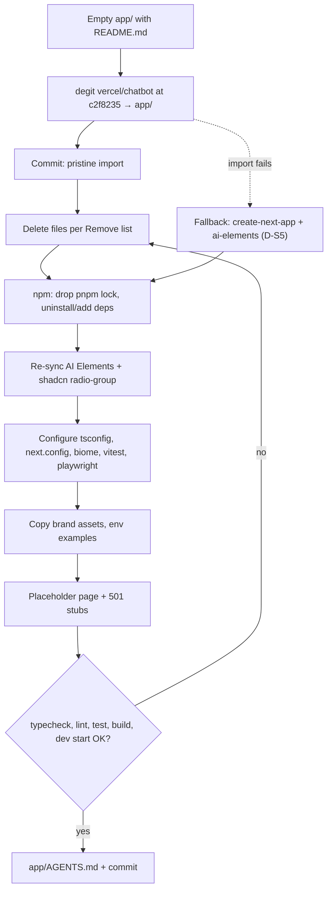
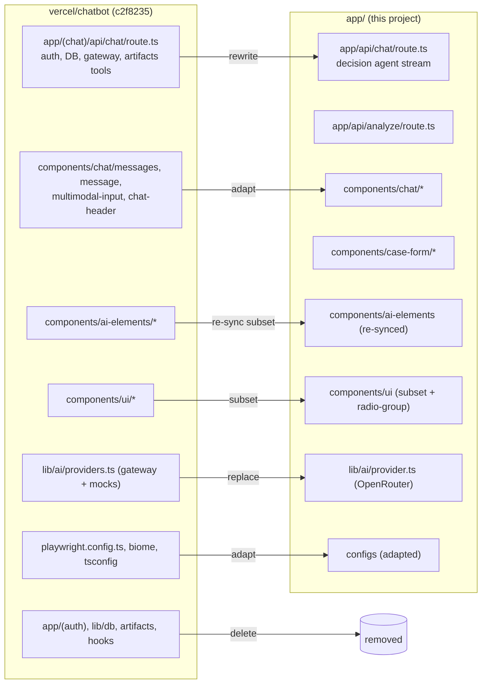

# ADR-001: Project Scaffold and Initialization

**Date:** 2026-10-21
**Status:** Accepted
**Relates to:** `docs/ADR/000-main-architecture.md`

---

## 1. Scope

How the empty `app/` folder becomes a working Next.js App Router project with TypeScript strict mode, AI SDK 7, OpenRouter, AI Elements, Vitest and Playwright: which template is used, the exact import and stripping procedure, dependency changes, configuration, brand assets and the checks that close the scaffold task.

Not covered: feature implementation (ADR-002 to ADR-004) and test cases (ADR-005).

---

## 2. Technology Documentation References

| Library | Context7 ID or official docs | Used for |
|---|---|---|
| Vercel Chatbot template | https://github.com/vercel/chatbot, commit `c2f8235e1f3ea903ad8b7f61447c4f74164b5c58` (2026-07-08) | Scaffold base |
| Next.js | `/vercel/next.js` | `next.config.ts`, App Router layout, `next/font/local`, `create-next-app` reference |
| AI Elements | `/vercel/ai-elements` | `npx ai-elements@latest add <component>` |
| shadcn/ui | `/shadcn-ui/ui` | `npx shadcn@latest add <component>`, `components.json`, theme variables |
| AI SDK | `/vercel/ai` | Package versions and APIs |
| OpenRouter provider | https://github.com/OpenRouterTeam/ai-sdk-provider | Version compatibility (`3.x` ↔ `ai@^7`, Node ≥ 22, ESM-only) |
| Vitest | `/vitest-dev/vitest` | Test runner setup with React + jsdom |
| Playwright | `/microsoft/playwright` | `playwright.config.ts` |
| degit | https://github.com/Rich-Harris/degit | Copying a repo snapshot at a commit without git history |

---

## 3. Component Design

### 3.1 Template research summary (2026-10-21)

| Candidate | State | Decision |
|---|---|---|
| `vercel/chatbot` ("Chatbot (formerly AI Chatbot)", demo `chatbot.ai-sdk.dev`) | Maintained; Next 16.2.10, React 19.2.7, `ai` 7.0.15, `@ai-sdk/react` 4.0.16, AI Elements, Streamdown 2, Tailwind 4, shadcn/ui, Playwright 1.61, Biome/Ultracite, pnpm 10. Requires Auth.js, Postgres (Drizzle), Vercel Blob, Redis, BotID, AI Gateway. Apache-2.0 (Vercel, Inc.). | **Chosen**, pinned to `c2f8235e1f3ea903ad8b7f61447c4f74164b5c58` and stripped. |
| `create-next-app@16.4` + `npx ai-elements@latest` (AI Elements "Chatbot" example) | Current, but only a recipe; no repo, no tests, no chat wiring. | Fallback only if the template import fails (§6 D-S5). |
| assistant-ui `npx assistant-ui@latest create -e with-ai-sdk-v7` | Current, AI SDK 7. | Rejected: different UI library (ADR-000 §1.1). |
| `vercel-labs/ai-sdk-preview-attachments` (Vercel "Multi-Modal Chatbot") | Next 14.2.5, `ai` ^4. | Rejected: outdated. |
| `vercel-labs/ai-sdk-reasoning-starter` | Archived 2026-06-25. | Rejected. |
| chat-sdk.dev | Bot SDK for Slack/Teams/Discord (`vercel/chat`). | Rejected: not a web app template. |
| OpenRouter + Next.js + AI SDK starter | No official OpenRouter starter found (OpenRouter docs show only provider snippets; `openrouter-tool-calling.vercel.app` is a demo without a documented repo). | Not available; the provider is added to the chosen template. |

### 3.2 Initialization procedure

Each step ends with the check in the last column. Steps 1–2 produce one pristine-import commit so the stripping diff is reviewable.

| # | Step | Details | Check |
|---|---|---|---|
| 1 | Preconditions | Node ≥ 22 (VM: 24.22.0), npm available, `app/` contains only `README.md`, the working tree is clean, and `docs/PRD.md`, `docs/policies/`, `docs/ADR/`, `docs/design-guidelines.md` and `assets/` are tracked in git (worktrees and fresh clones depend on them; policies are read at runtime). | `node -v`, `git status`, `git ls-files docs assets` |
| 2 | Import template | Run `npx degit vercel/chatbot#c2f8235e1f3ea903ad8b7f61447c4f74164b5c58 app --force` from the repository root. This overwrites `app/README.md` (the course checklist stays in git history; its items are covered by this ADR). Confirm `app/LICENSE` is Apache-2.0 (Vercel, Inc.); stop and ask the user if it is not. Commit as `Scaffold: Import vercel/chatbot template at c2f8235`. This vendor-import commit is a deliberate exception to the AGENTS.md rule "commit only after verification passes": it is not expected to build (it needs auth/DB services) and exists only so the stripping diff in step 14 is reviewable. | `app/package.json` shows `"ai": "7.0.15"`; `app/LICENSE` checked |
| 3 | Remove files | Delete everything in §3.4 "Remove". | `git status` shows only deletions |
| 4 | Switch to npm | Delete `pnpm-lock.yaml` and the `packageManager` field; replace scripts per §3.5. | `package.json` has no `pnpm` reference |
| 5 | Dependencies | Uninstall the packages in §3.6 "Remove"; install/upgrade those in §3.6 "Add/upgrade" with npm. Generates `package-lock.json`. | `npm ls --depth=0` has no errors; TAC-001-03 |
| 6 | Re-sync AI Elements | Run `npx ai-elements@latest add conversation message prompt-input shimmer` and accept overwrites so the vendored components match the current registry. Delete AI Elements components not in §3.4 "Keep". | Files exist under `components/ai-elements/` |
| 7 | shadcn primitives | Run `npx shadcn@latest add radio-group` (case channel). Keep the existing primitives listed in §3.4. | `components/ui/radio-group.tsx` exists |
| 8 | Configuration | Apply §3.7 (`next.config.ts`, `tsconfig.json`, `biome.jsonc`, `playwright.config.ts`, `vitest.config.ts`, `.gitignore`). | `npx tsc --noEmit` |
| 9 | Brand assets | Copy `assets/logo.svg` → `app/public/logo.svg`; `assets/favicon.ico` → `app/app/favicon.ico` (replaces template icon); `assets/fonts/instrument-sans/InstrumentSans-Variable.woff2` → `app/app/fonts/InstrumentSans-Variable.woff2`, loaded with `next/font/local` (weight range 400–700). Map tokens per ADR-004 §3.7. | Visual check in step 12 |
| 10 | Environment | Load the repository-root `.env` from `next.config.ts` via `loadEnvConfig` (`@next/env`) with the root directory; do not create any `app/.env*` file. Ensure the root `.env.example` lists all ADR-000 §7 variables. Never read or edit `.env` (the user creates it). | `ls app/.env*` finds nothing; `git check-ignore .env` succeeds |
| 11 | Placeholder app | Replace the template routes with an empty `app/page.tsx` rendering the header (logo + "Asystent zwrotów i reklamacji") and stub route handlers returning `501` for `/api/analyze` and `/api/chat`. | `npm run build` passes |
| 12 | Start and verify | `npm run dev`, open `http://localhost:3000` with Playwright CLI, take a screenshot. | HTTP 200, header visible, no console errors |
| 13 | Nested agent guide | Create `app/AGENTS.md` with the verified commands (§3.5), stack facts and the rule to consult Context7 `/vercel/ai` before AI code (use the `write-agents-md` skill). | File exists, commands verified |
| 14 | Commit | `Scaffold: Strip template to PRD scope and switch to OpenRouter` | Clean `git status` |

### 3.3 Target `app/` structure after scaffolding and implementation

```
app/
├── app/
│   ├── layout.tsx                 html lang="pl", font, metadata, Toaster
│   ├── page.tsx                   renders <CaseFlow/> (client)
│   ├── globals.css                Tailwind 4 + x-kom token variables
│   ├── favicon.ico
│   ├── fonts/InstrumentSans-Variable.woff2
│   └── api/
│       ├── analyze/route.ts
│       └── chat/route.ts
├── components/
│   ├── ai-elements/               conversation, message, prompt-input, shimmer (vendored)
│   ├── ui/                        shadcn primitives (vendored)
│   ├── layout/                    app-header
│   ├── case-form/                 case-form, case-type-tiles, photo-field, processing-steps, error-banner
│   ├── chat/                      chat-screen, case-summary, decision-card, decision-badge,
│   │                              message-list, chat-message, chat-input, photo-overlay, new-case-dialog
│   └── case-flow.tsx              screen switch, session provider, useChat owner
├── lib/
│   ├── case/                      constants, schemas, days, labels, texts (Polish UI strings), errors
│   ├── image/                     sniff (shared), reduce (client)
│   ├── session/                   reducer, context, deadline watchdog
│   ├── ai/                        server-only: env, provider, policies, prompts/, image-analyst,
│   │                              decision-agent, tools
│   └── utils.ts                   cn() from template
├── tests/
│   ├── integration/               route handler tests (Vitest)
│   ├── contract/                  real HTTP contract tests (Playwright request)
│   ├── e2e/                       real browser flows (Playwright)
│   ├── fixtures/
│   │   └── captures/              verbatim real responses (+ metadata); test photos stay in /assets/example-images
│   └── README.md                  AC → test ID traceability table
├── public/logo.svg
├── AGENTS.md
├── LICENSE                        template license retained (Apache-2.0, Vercel)
├── README.md                      project README (commands, env, links to docs/)
├── biome.jsonc, components.json, next.config.ts, postcss.config.mjs
├── playwright.config.ts, playwright.capture.config.ts, vitest.config.ts, tsconfig.json
└── package.json, package-lock.json
```

Unit tests are colocated next to their source as `*.test.ts` / `*.test.tsx`.

### 3.4 Keep / remove list (paths relative to `app/` after import)

**Keep and adapt**

| Path | Adaptation |
|---|---|
| `app/layout.tsx`, `app/globals.css` | Remove theme provider/dark mode, auth/session providers, analytics; set `lang="pl"`; replace CSS variables with x-kom tokens (ADR-004 §3.7). |
| `components/ai-elements/{conversation,message,prompt-input,shimmer}.tsx` | Re-synced in step 6; styling via tokens only. |
| `components/ui/{alert-dialog,badge,button,collapsible,dialog,input,input-group,button-group,label,select,separator,skeleton,spinner,textarea,tooltip,popover,scroll-area}.tsx` | Keep; delete any of these that has no import after implementation. |
| `components/chat/messages.tsx`, `message.tsx`, `multimodal-input.tsx`, `chat-header.tsx`, `toast.tsx` | Starting points for `message-list`, `chat-message`, `chat-input` (attachments removed), `app-header`, toasts; rename to the target names in §3.3. |
| `lib/utils.ts` | Keep `cn()`; delete other helpers that depend on removed modules. |
| `components.json`, `postcss.config.mjs`, `biome.jsonc`, `tsconfig.json`, `next.config.ts`, `playwright.config.ts`, `.gitignore`, `LICENSE` | Adapt per §3.7. |

**Remove**

| Path | Reason |
|---|---|
| `app/(auth)/**` | No authentication (PRD §7). |
| `app/(chat)/**` (all routes: `api/chat/[id]/stream`, `api/document`, `api/files/upload`, `api/history`, `api/messages`, `api/models`, `api/suggestions`, `api/vote`, `chat/[id]`, `actions.ts`, OG images) | Replaced by `app/page.tsx`, `/api/analyze`, `/api/chat`. |
| `artifacts/**`, `lib/artifacts/**`, `lib/editor/**` | Document/code/sheet artifacts are out of scope. |
| `lib/db/**`, `drizzle.config.ts` | No persistence. |
| `lib/ai/**` (entitlements, models, models.mock, models.test, prompts, providers, tools/*) | Rewritten for OpenRouter and this domain (ADR-002). |
| `lib/ratelimit.ts`, `lib/constants.ts`, `lib/types.ts`, `lib/errors.ts` | Depend on removed auth/DB/gateway; replaced by `lib/case/*`. |
| `hooks/**` | Replaced by `lib/session` and AI Elements behaviour. |
| `components/chat/*` not listed under Keep (sidebar, artifact, document, editors, auth, visibility, suggestions, weather, slash commands, greeting, toolbar, version footer, data-stream provider/handler, preview, diffview, console, icons) | Out of scope. |
| `components/ai-elements/{code-block,model-selector,reasoning,suggestion,tool}.tsx` | Not used (no code blocks, model picker, reasoning display, suggestions; decision card is custom). |
| `components/ui/{sidebar,sheet,command,dropdown-menu,hover-card}.tsx`, `components/theme-provider.tsx` | No sidebar navigation, command palette or theming. |
| `proxy.ts`, `instrumentation.ts`, `instrumentation-client.ts` | Auth middleware, OpenTelemetry, BotID. |
| `vercel.json`, `vercel-template.json` | No Vercel deployment. |
| `public/images/**`, `public/preview.png` | Template images. |
| `tests/**` (template tests, page objects, prompt mocks) | Template tests use mock models in test mode, which contradicts the no-mock E2E rule; replaced by ADR-005 suites. |
| `.cursor/`, `.github/`, `.husky/`, `.vscode/` | Course repository root manages editor/CI/hooks; husky cannot install hooks from a subfolder of the git root. |
| `pnpm-lock.yaml` | npm is used. |

### 3.5 `package.json` scripts

| Script | Command | Purpose |
|---|---|---|
| `dev` | `next dev` | Turbopack dev server (default in Next 16) |
| `build` | `next build` | Production build (no DB migration step) |
| `start` | `next start` | Production server for manual QA |
| `typecheck` | `tsc --noEmit` | TAC-01 |
| `lint` | `ultracite check` | Biome lint + format check |
| `format` | `ultracite fix` | Auto-fix |
| `test` | `vitest run` | Unit + integration |
| `test:watch` | `vitest` | TDD loop |
| `test:contract` | `playwright test --project=contract` | Real HTTP contract tests |
| `test:e2e` | `playwright test --project=chromium --project=firefox --project=webkit` | Real browser E2E (Firefox and WebKit projects run only tests tagged `@smoke`, via `grep` in their project config) |
| `capture` | `playwright test --config=playwright.capture.config.ts` | Refresh verbatim captures; the capture config starts its own server with `AI_CAPTURE_DIR` set (ADR-005 §3.3) |

### 3.6 Dependency changes

**Remove:** `@ai-sdk/otel`, `@ai-sdk/provider` (unless a type import remains), `@codemirror/*`, `codemirror`, `@opentelemetry/*`, `@vercel/otel`, `@vercel/analytics`, `@vercel/blob`, `@vercel/functions`, `bcrypt-ts`, `botid`, `classnames`, `diff-match-patch`, `dotenv` (`next.config.ts` uses `@next/env`; Playwright configs use Node's `process.loadEnvFile`), `drizzle-orm`, `drizzle-kit`, `katex`, `@streamdown/cjk`, `@streamdown/code`, `@streamdown/math`, `@streamdown/mermaid`, `next-auth`, `next-themes`, `orderedmap`, `papaparse`, `@types/papaparse`, `@types/pdf-parse`, `@types/d3-scale`, `postgres`, `prosemirror-*`, `react-data-grid`, `redis`, `resumable-stream`, `swr`, `tsx`, `husky`, `lint-staged`. After implementation, also remove any remaining dependency with zero imports (verify by searching the source tree).

**Add / upgrade** (latest within the stated major at install time; record exact versions in the scaffold commit message):

| Package | Range | Reason |
|---|---|---|
| `ai` | `^7` | Template pins 7.0.15; latest 7.0.148 |
| `@ai-sdk/react` | `^4` | Matches `ai@7` |
| `@openrouter/ai-sdk-provider` | `^3.1` | Provider for `ai@^7` |
| `next` | `^16` | Latest 16.4.x |
| `react`, `react-dom` | `^19` | Latest 19.x |
| `@types/react`, `@types/react-dom` | `^19` | Template wrongly pins `^18` |
| `zod` | `^4` | Already present |
| `date-fns`, `@date-fns/tz` | `^4`, latest | Calendar-day difference in Europe/Warsaw |
| `server-only` | keep | Guards `lib/ai` from client import |
| Dev: `vitest` | `^5` | Unit/integration |
| Dev: `@vitejs/plugin-react`, `vite-tsconfig-paths`, `jsdom` | latest | Vitest React + `@/*` alias |
| Dev: `@testing-library/react`, `@testing-library/dom`, `@testing-library/user-event`, `@testing-library/jest-dom` | latest | Component tests |
| Dev: `@playwright/test` | `^1.64` | E2E/contract; run `npx playwright install --with-deps chromium firefox webkit` |

### 3.7 Configuration

- **`tsconfig.json`**: keep `"strict": true` (present in template); add `"noUncheckedIndexedAccess": true` and `"noFallthroughCasesInSwitch": true`; keep `@/*` → `./*`; exclude `tests/fixtures`.
- **`next.config.ts`**: remove `withBotId`, demo `basePath`/`assetPrefix`/redirect, `images.remotePatterns`, `cacheComponents` and all `experimental` flags; keep `reactCompiler: true` and `poweredByHeader: false`. Rationale: fewer moving parts; Cache Components brings no value to a client page plus two POST handlers.
- **Route handlers**: `export const runtime = 'nodejs'` (policy file reads, Buffer handling); `/api/analyze` `maxDuration = 60`, `/api/chat` `maxDuration = 120`.
- **`biome.jsonc`**: keep Ultracite preset; ignore `components/ai-elements/**` and `components/ui/**` from lint rules that would force edits to vendored code (format still applies).
- **`playwright.config.ts`**: load the repository-root `.env` with Node's `process.loadEnvFile('../.env')`; projects `contract` (no browser, `tests/contract`), `chromium`, `firefox` and `webkit` (`tests/e2e`; Firefox/WebKit `grep` `@smoke`), `failure` (E-22); two `webServer` entries on the production build — port 3000 (`reuseExistingServer: true`, `AI_CAPTURE_DIR` unset) and port 3200 with invalid model IDs (ADR-005 §3.1); a global setup that aborts if `AI_CAPTURE_DIR` is set; **`playwright.capture.config.ts`**: own server on port 3100 with `AI_CAPTURE_DIR`, `reuseExistingServer: false`, `grep` `@capture`; test timeout 180 s, expect timeout 90 s (real LLM latency); `workers: 2`, `retries: 0` (flakiness must be visible); traces, screenshots and video retained on failure.
- **`vitest.config.ts`**: plugins React + tsconfig paths; `environment: 'jsdom'` for `components/**` and `lib/session/**`, `node` for `lib/case/**`, `lib/ai/**`, `tests/integration/**` (per-file environment comments or `projects`); setup file registers `@testing-library/jest-dom`; exclude `tests/e2e`, `tests/contract`.
- **`.gitignore`**: keep template entries; ensure `.env*.local`, `test-results/`, `playwright-report/`, `.next/` are ignored; `tests/fixtures/captures/` is **tracked**.

---

## 4. Data Structures

| Artifact | Content |
|---|---|
| Root `.env.example` | `OPENROUTER_API_KEY=`, `ANTHROPIC_API_KEY=` (unused by the app), `LLM_MODEL=` (required), `VISION_MODEL=`, `AI_CAPTURE_DIR=`, `POLICIES_DIR=`, `PORT=` with one-line comments |
| Scaffold commit message | Lists exact installed versions of `next`, `react`, `ai`, `@ai-sdk/react`, `@openrouter/ai-sdk-provider`, `zod`, `vitest`, `@playwright/test` |

---

## 5. Interface Contracts

After step 11 the placeholder exposes:

| Interface | Contract |
|---|---|
| `GET /` | 200 HTML with header logo and title "Asystent zwrotów i reklamacji" |
| `POST /api/analyze` | 501 `{ "error": { "code": "NOT_IMPLEMENTED", "message": "…" } }` until ADR-003 is implemented |
| `POST /api/chat` | 501, same envelope |

---

## 6. Technical Decisions

### D-S1 Use the Vercel Chatbot template at a pinned commit
**Status:** Accepted
**Date:** 2026-10-21
**Context:** The user requires starting from an existing chat template rather than bare `create-next-app`. Only one official template combines Next 16, AI SDK 7 and AI Elements.
**Decision:** Import `vercel/chatbot` at `c2f8235e1f3ea903ad8b7f61447c4f74164b5c58` with `degit` (no template git history), commit pristine, then strip.
**Rejected alternatives:**
- Cloning `main` unpinned: non-reproducible across participants' VMs.
- `git clone` with history: pollutes the course repository with a foreign history.
**Consequences:**
- (+) Reproducible, reviewable import; current versions of the whole stack.
- (-) About two thirds of the template is deleted.
**Review trigger:** A new template commit that removes the need for stripping (e.g. an official "no-auth" variant).

### D-S2 npm instead of the template's pnpm
**Status:** Accepted
**Date:** 2026-10-21
**Context:** The template declares `pnpm@10.32.1`; the VM has npm and corepack 0.36 but no pnpm shim, and `corepack enable` writes to a root-owned directory.
**Decision:** Use npm; regenerate the lockfile.
**Rejected alternatives:**
- `corepack pnpm …` everywhere: extra prefix on every command for participants.
**Consequences:**
- (+) Zero setup on the VM.
- (-) Template lockfile resolution is lost; versions are re-resolved (acceptable: we upgrade anyway).
**Review trigger:** If the course VMs ship with pnpm.

### D-S3 Keep Biome/Ultracite instead of ESLint
**Status:** Accepted
**Date:** 2026-10-21
**Context:** `create-next-app` would set up ESLint; the template is configured for Biome via Ultracite.
**Decision:** Keep the template's Biome/Ultracite config; no ESLint.
**Rejected alternatives:**
- Replace with ESLint + Prettier: extra work, no functional benefit.
**Consequences:**
- (+) One fast tool for lint and format.
- (-) Next.js-specific ESLint rules are unavailable.
**Review trigger:** If a required Next.js lint rule has no Biome equivalent.

### D-S4 Light theme only
**Status:** Accepted
**Date:** 2026-10-21
**Context:** The x-kom brand reference is light-only; the template ships a dark mode toggle.
**Decision:** Remove `next-themes`/dark variables; one light theme from tokens.
**Rejected alternatives:**
- Keep dark mode: no brand reference to QA it against.
**Consequences:**
- (+) Simpler CSS and QA.
- (-) No dark mode.
**Review trigger:** Brand provides dark tokens.

### D-S5 Fallback scaffold
**Status:** Accepted
**Date:** 2026-10-21
**Context:** The template import depends on GitHub availability and the pinned commit.
**Decision:** If step 2 fails (network, commit missing), scaffold with `npx create-next-app@latest app --ts --app --tailwind --biome --import-alias "@/*" --use-npm --disable-git --yes`, then `npx ai-elements@latest` (installs shadcn + all components), then continue from step 5. Record the deviation in the scaffold commit.
**Rejected alternatives:**
- Blocking until the template is reachable.
**Consequences:**
- (+) Course can proceed.
- (-) Chat wiring must be written from the AI Elements docs.
**Review trigger:** n/a.

### D-S6 Template tests are discarded
**Status:** Accepted
**Date:** 2026-10-21
**Context:** Template E2E tests switch the app to mock models (`isTestEnvironment`, `models.mock.ts`), which contradicts the no-mock E2E rule and tests features we delete.
**Decision:** Delete them; keep only the Playwright config structure.
**Rejected alternatives:**
- Keep and adapt: little overlap with PRD flows.
**Consequences:**
- (+) No hidden mock path in production code.
- (-) Test suites are written from scratch (ADR-005).
**Review trigger:** n/a.

---

## 7. Diagrams

### Scaffold flow



### Template-to-target mapping



---

## 8. Testing Strategy

### Test scenarios for this area

| Scenario | Type | Input | Expected output | Edge cases |
|---|---|---|---|---|
| Clean install | Command | `rm -rf node_modules && npm ci` | Exit 0, no peer-dependency errors | Node 24 |
| Type safety | Command | `npm run typecheck` | Exit 0 | `strict`, `noUncheckedIndexedAccess` |
| Lint | Command | `npm run lint` | Exit 0 | Vendored folders formatted |
| Unit runner works | Command | `npm test` with one smoke test (`cn()` merges classes) | 1 passed, 0 skipped | jsdom and node environments both load |
| Build | Command | `npm run build` | Exit 0, no warnings introduced | No `DATABASE`/`AUTH_SECRET` required |
| Startup | Command + browser | `npm run dev`, Playwright CLI opens `/` | HTTP 200, header and logo visible, console clean | Font loads (no fallback flash in screenshot) |
| Stubs | HTTP | `POST /api/analyze`, `POST /api/chat` | 501 with error envelope | — |
| No forbidden deps | Command | search `package.json` and source | None of TAC-07 packages present | — |

### Technical acceptance criteria

- TAC-001-01: `app/` contains no file from the §3.4 "Remove" list.
- TAC-001-02: `npm ci && npm run typecheck && npm run lint && npm test && npm run build` exits 0 on a fresh VM with only the repository-root `.env` configured.
- TAC-001-03: `package.json` resolves `ai` ≥ 7.0.148, `@ai-sdk/react` 4.x, `@openrouter/ai-sdk-provider` ≥ 3.1.0, `next` 16.x, `react` 19.x.
- TAC-001-04: The app starts without any of `AUTH_SECRET`, `POSTGRES_URL`, `BLOB_READ_WRITE_TOKEN`, `REDIS_URL`, `AI_GATEWAY_API_KEY` defined.
- TAC-001-05: Git history contains a pristine import commit followed by a separate stripping commit.
- TAC-001-06: `app/LICENSE` (Apache-2.0, Vercel, Inc.) is retained.
