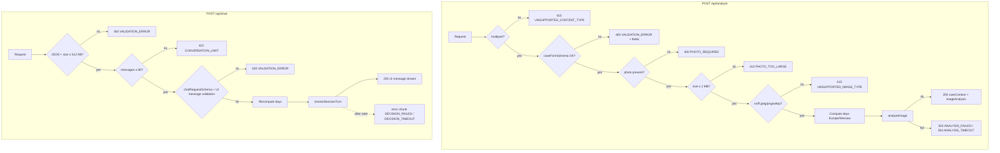

# ADR-003: Backend API — Route Handlers

**Date:** 2026-10-21
**Status:** Accepted
**Relates to:** `docs/ADR/000-main-architecture.md`

---

## 1. Scope

Defines the two Next.js App Router route handlers, `POST /api/analyze` and `POST /api/chat`: request parsing, validation, file checks, day-count calculation, response and error envelopes, status codes, limits and security rules.

Not covered: prompt content and model calls (ADR-002), client behaviour (ADR-004).

---

## 2. Technology Documentation References

| Library | Context7 ID or official docs | Used for |
|---|---|---|
| Next.js route handlers | `/vercel/next.js` | `app/api/*/route.ts`, `runtime`, `maxDuration`, `Request.formData()` |
| AI SDK 7 UI | `/vercel/ai` | `validateUIMessages` / `safeValidateUIMessages`, UI message stream response |
| Zod 4 | `/colinhacks/zod` | Shared schemas, `safeParse`, error flattening |
| date-fns 4 + `@date-fns/tz` | https://date-fns.org/docs/Getting-Started | Calendar-day difference in `Europe/Warsaw` |

---

## 3. Component Design

| Layer | Location | Responsibility |
|---|---|---|
| Route handler | `app/api/analyze/route.ts`, `app/api/chat/route.ts` | HTTP only: parse, call validators and services, map errors to envelopes. No business rules inline. |
| Shared schemas | `lib/case/schemas.ts` | `caseFormSchema` (also used by the client form), `caseContextSchema`, `imageAnalysisSchema`, `chatRequestSchema`, `errorEnvelopeSchema`, `analyzeResponseSchema` |
| Days | `lib/case/days.ts` | `todayInWarsaw()`, `daysSincePurchase(purchaseDate, today)` — integer calendar days, never negative |
| Sniffing | `lib/image/sniff.ts` | Detect `jpeg` (`FF D8 FF`), `png` (`89 50 4E 47 0D 0A 1A 0A`), `webp` (`RIFF`…`WEBP` at bytes 8–11) from the first 12 bytes; everything else (incl. HEIC `ftyp`) is `unknown`. Shared by client and server. |
| Errors | `lib/case/errors.ts` | `AppErrorCode` enum, Polish user-facing messages, `errorResponse(code, status, fields?)` |
| Services | `lib/ai/*` | ADR-002 |

Handlers are stateless; no module-level mutable state except caches of env and policies.

---

## 4. Data Structures

### 4.1 `caseFormSchema` (field rules identical on client and server)

| Field | Rule | Error message (Polish, PRD) |
|---|---|---|
| `caseType` | enum `return`, `complaint` | "Wybierz rodzaj zgłoszenia" |
| `purchaseChannel` | enum `online`, `in_store` | "Wybierz miejsce zakupu" |
| `category` | enum of 9 values (ADR-000 §5) | "Wybierz kategorię sprzętu" |
| `modelName` | trim, length 2–100 | "Podaj nazwę lub model sprzętu (min. 2 znaki)" (AC-05) |
| `purchaseDate` | `YYYY-MM-DD`, valid calendar date, ≤ today in Europe/Warsaw | "Data zakupu nie może być z przyszłości" (AC-06); missing → "Podaj datę zakupu" |
| `reason` | ≤ 2000 chars; when `complaint`: trimmed length ≥ 20 | "Opisz problem (min. 20 znaków)" (AC-07) |

Messages not given verbatim by the PRD ("Wybierz…", "Podaj datę zakupu") are product copy defined here and kept in `lib/case/texts.ts`.

### 4.2 `CaseContext`

`caseFormSchema` output (without photo) + `daysSincePurchase` (int ≥ 0) + `assessmentDate` (`YYYY-MM-DD`, Europe/Warsaw).

### 4.3 `AnalyzeResponse`

`{ caseContext: CaseContext, imageAnalysis: ImageAnalysis }`.

### 4.4 `ChatRequest`

| Field | Rule |
|---|---|
| `id` | string 1–100 (chat ID from `useChat`) |
| `messages` | non-empty array of `CaseUIMessage` (the 60-message cap is checked before schema validation, §5.2); validated with the AI SDK UI message validator using `metadataSchema` (`kind` enum) and the `set_decision` history schema |
| `caseContext` | `caseContextSchema` |
| `imageAnalysis` | `imageAnalysisSchema`, `variant` must equal `caseContext.caseType` |

Additional rules: the last message has role `user`; every user text part trimmed length 1–2000; at most one message with `kind = case-submission` and it must be the first; user messages contain only text parts (no file parts — AC-44).

### 4.5 Error envelope

`{ error: { code: AppErrorCode, message: string, fields?: Record<fieldName, message> } }`

| Code | HTTP | Message (Polish) |
|---|---|---|
| `VALIDATION_ERROR` | 400 | "Nieprawidłowe dane zgłoszenia." (+ `fields`) |
| `PHOTO_REQUIRED` | 400 | "Dodaj zdjęcie sprzętu." |
| `UNSUPPORTED_IMAGE_TYPE` | 415 | "Dozwolone formaty: JPG, PNG, WebP" (AC-11) |
| `PHOTO_TOO_LARGE` | 413 | "Zdjęcie po zmniejszeniu przekracza 1 MB." |
| `UNSUPPORTED_CONTENT_TYPE` | 415 | "Nieobsługiwany format żądania." |
| `CONVERSATION_LIMIT` | 422 | "Osiągnięto limit długości rozmowy. Rozpocznij nowe zgłoszenie." |
| `ANALYSIS_FAILED` | 502 | "Nie udało się przeanalizować zgłoszenia. Spróbuj ponownie." (AC-22) |
| `ANALYSIS_TIMEOUT` | 504 | same as above |
| `CONFIGURATION_ERROR` | 500 | "Usługa jest chwilowo niedostępna." |
| `NOT_IMPLEMENTED` | 501 | scaffold only |

In-stream errors (`/api/chat`) carry the code string only (`DECISION_FAILED`, `DECISION_TIMEOUT`); the client maps codes to Polish texts.

---

## 5. Interface Contracts

### 5.1 `POST /api/analyze`

- **Runtime**: `nodejs`; `maxDuration = 60`.
- **Request**: `Content-Type: multipart/form-data`; text fields per §4.1 (`reason` may be empty string); file field `photo`.
- **Processing order**:
  1. Reject non-multipart → 415 `UNSUPPORTED_CONTENT_TYPE`.
  2. Read form data; validate text fields with `caseFormSchema` → 400 `VALIDATION_ERROR` with `fields`.
  3. `photo` missing or empty → 400 `PHOTO_REQUIRED`; size > 1 048 576 bytes → 413 `PHOTO_TOO_LARGE`; sniff bytes, `unknown` → 415 `UNSUPPORTED_IMAGE_TYPE`. The declared MIME type and file name are ignored.
  4. Compute `assessmentDate` and `daysSincePurchase`.
  5. `analyzeImage` with `request.signal`.
  6. 200 `AnalyzeResponse`.
- **Errors**: as in §4.5; AI errors → 502/504.
- **Headers**: `Cache-Control: no-store`.

### 5.2 `POST /api/chat`

- **Runtime**: `nodejs`; `maxDuration = 120`.
- **Request**: `Content-Type: application/json`; body `ChatRequest` (§4.4). Max body size enforced by checking `Content-Length` ≤ 512 KB (a 60-message conversation with 2000-char messages and the analysis fits well below).
- **Processing order**:
  1. Parse JSON → 400 on failure.
  2. If `messages` is an array with more than 60 items → 422 `CONVERSATION_LIMIT` (checked first, so the limit is reported even when other fields are also invalid).
  3. Validate with `chatRequestSchema` and the UI message validator → 400 `VALIDATION_ERROR`.
  4. Recompute `daysSincePurchase` and `assessmentDate` from `caseContext.purchaseDate` (client values ignored, D-07).
  5. `streamDecisionTurn` with `request.signal`.
- **Response**: 200 UI message stream (AI SDK protocol, `text/event-stream`), `Cache-Control: no-store`.
- **Errors**: pre-stream errors as JSON envelopes (§4.5); errors after the stream started as error chunks (ADR-002 §5.3).

### 5.3 Day calculation

`daysSincePurchase = differenceInCalendarDays(todayInWarsaw, purchaseDate)`, where both are calendar dates in `Europe/Warsaw`. Purchase today → 0. Thresholds in the prompt use inclusive bounds (≤ 14, ≤ 30, ≤ 730) as in PRD §8.

---

## 6. Technical Decisions

### D-API1 Multipart upload for analysis
**Status:** Accepted
**Date:** 2026-10-21
**Context:** One ≤ 1 MB binary photo plus text fields.
**Decision:** `multipart/form-data` read with `Request.formData()`.
**Rejected alternatives:**
- Base64 JSON: +33% size and a second encoding step.
**Consequences:**
- (+) Native browser `FormData`, binary transfer.
- (-) Contract tests must build multipart bodies.
**Review trigger:** n/a.

### D-API2 Magic-byte sniffing, no extension/MIME trust
**Status:** Accepted
**Date:** 2026-10-21
**Context:** AC-10 requires detection by content.
**Decision:** A 12-byte signature check shared by client and server; no dependency.
**Rejected alternatives:**
- `file-type` package: larger than needed for three formats.
**Consequences:**
- (+) Same logic both sides; trivially unit-tested.
- (-) Only three formats recognised (by design).
**Review trigger:** New accepted formats.

### D-API3 Server recomputes days on every turn
**Status:** Accepted
**Date:** 2026-10-21
**Context:** The PRD says the system computes the day count; the client transports the context.
**Decision:** Both endpoints compute days from `purchaseDate` with the Warsaw calendar; the client copy is display-only.
**Rejected alternatives:**
- Trust the client value: trivially manipulable.
**Consequences:**
- (+) Deterministic, tamper-resistant deadlines.
- (-) A case open across midnight may show one day more in later replies (correct behaviour).
**Review trigger:** n/a.

### D-API4 Conversation cap of 60 messages
**Status:** Proposed
**Date:** 2026-10-21
**Context:** PRD open question on AI cost control; stateless server resends the whole history.
**Decision:** Reject requests with more than 60 messages (≈ 30 exchanges) with `CONVERSATION_LIMIT`.
**Rejected alternatives:**
- No cap: unbounded token cost per session.
**Consequences:**
- (+) Bounded cost and request size.
- (-) Very long conversations must restart.
**Review trigger:** Product decision on the PRD open question.

### D-API5 No rate limiting in the MVP
**Status:** Accepted
**Date:** 2026-10-21
**Context:** Local VM only, anonymous users, no store for counters.
**Decision:** No rate limiting; documented as a production prerequisite.
**Rejected alternatives:**
- In-memory limiter: misleading guarantees with multiple workers.
**Consequences:**
- (+) Simple.
- (-) Not safe for public deployment.
**Review trigger:** Any public deployment.

---

## 7. Diagrams

### Request pipeline



### Sequence — validation failure

```mermaid
sequenceDiagram
    participant Client
    participant R as /api/analyze
    Client->>R: multipart with modelName "A", purchaseDate tomorrow
    R->>R: caseFormSchema.safeParse
    R-->>Client: 400 {error: {code: VALIDATION_ERROR, fields: {modelName: "Podaj nazwę…", purchaseDate: "Data zakupu nie może być z przyszłości"}}}
    Note over Client: Client-side validation should prevent this; server is the backstop
```

---

## 8. Testing Strategy

### Test scenarios for this area

| Scenario | Type | Input | Expected output | Edge cases |
|---|---|---|---|---|
| Form schema | Unit | each field at min, min−1, max, max+1 | Messages per §4.1 | `reason` whitespace-only for complaint; 2000 vs 2001 chars |
| Future date | Unit | today+1 in Warsaw | Error AC-06 | Day boundary at 23:30 UTC (already next day in Warsaw) |
| Days | Unit | purchase today / 14 / 15 / 30 / 31 / 730 / 731 days ago | 0 / 14 / 15 / 30 / 31 / 730 / 731 | DST change dates (last Sunday of March/October) |
| Sniff | Unit | JPEG, PNG, WebP, HEIC, GIF, PDF, empty, 5-byte file | jpeg/png/webp/unknown×5 | `.jpg` extension with PNG content → png |
| Analyze route: validation | Integration | invalid fields | 400 envelope with `fields` | missing photo, 1 MB + 1 byte, HEIC |
| Analyze route: success | Integration (mock model from capture) | valid multipart | 200 matching `analyzeResponseSchema`; `daysSincePurchase` computed with frozen clock | — |
| Analyze route: AI failure | Integration | mock throws API error / timeout | 502 / 504 envelope | — |
| Chat route: validation | Integration | 61 messages; file part in user message; 2001-char text; `variant` ≠ `caseType`; last message assistant | 422 / 400 / 400 / 400 / 400 | tampered `daysSincePurchase` ignored (prompt receives recomputed value) |
| Chat route: stream | Integration (mock model from capture) | first turn | Stream parses into UI message with tool part then text; `Content-Type: text/event-stream` | client abort ends stream without error chunk |
| Real contract: analyze | Contract (real OpenRouter) | each fixture image | Status 200 and body valid against schema; capture saved | HEIC → 415 without calling OpenRouter |
| Real contract: chat | Contract (real) | first turn for each fixture + one follow-up | Stream chunk sequence valid; exactly one `set_decision` before text | — |

### Technical acceptance criteria

- TAC-003-01: Both handlers return `Cache-Control: no-store`.
- TAC-003-02: A HEIC file renamed to `.jpg` with `Content-Type: image/jpeg` returns 415 and does not call OpenRouter (verified by mock call count in integration and by absence of usage in contract logs).
- TAC-003-03: For any `caseContext.daysSincePurchase` sent by the client, the instructions passed to the model contain the server-computed value.
- TAC-003-04: Every non-2xx JSON response validates against `errorEnvelopeSchema`.
- TAC-003-05: `/api/analyze` never returns raw provider error text.
