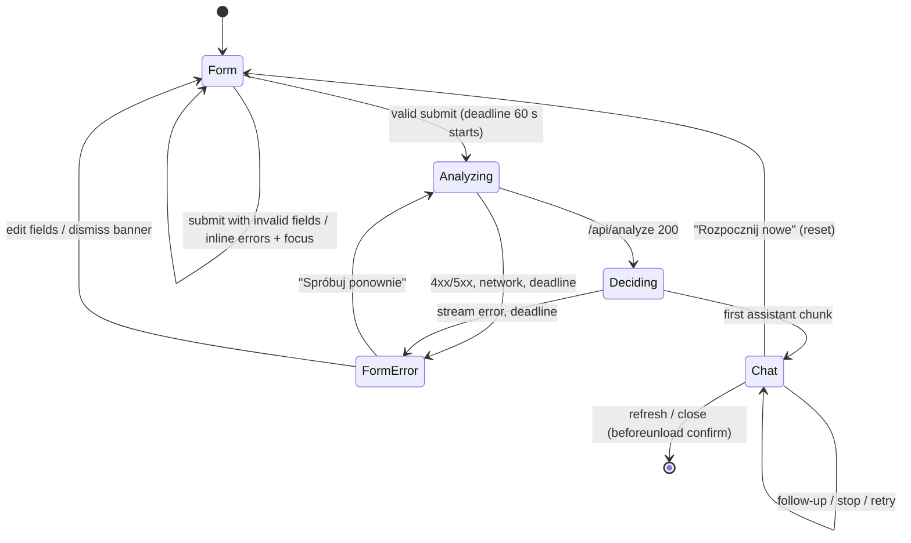
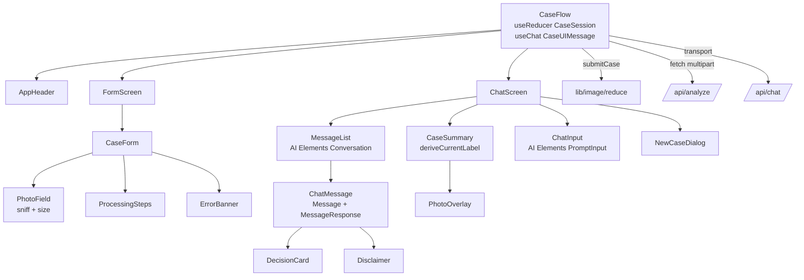
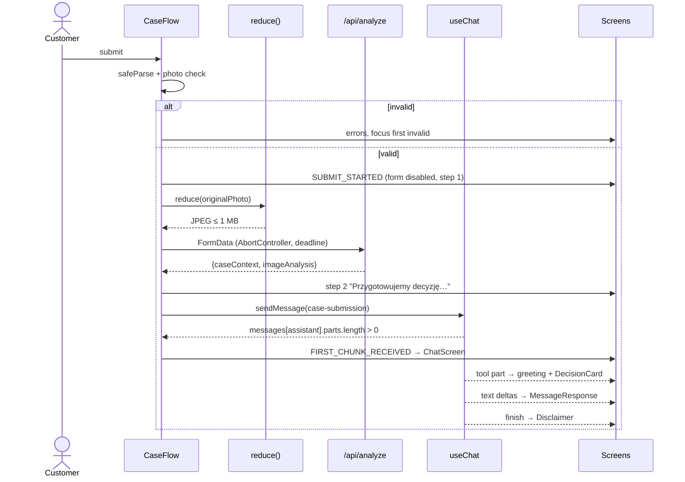
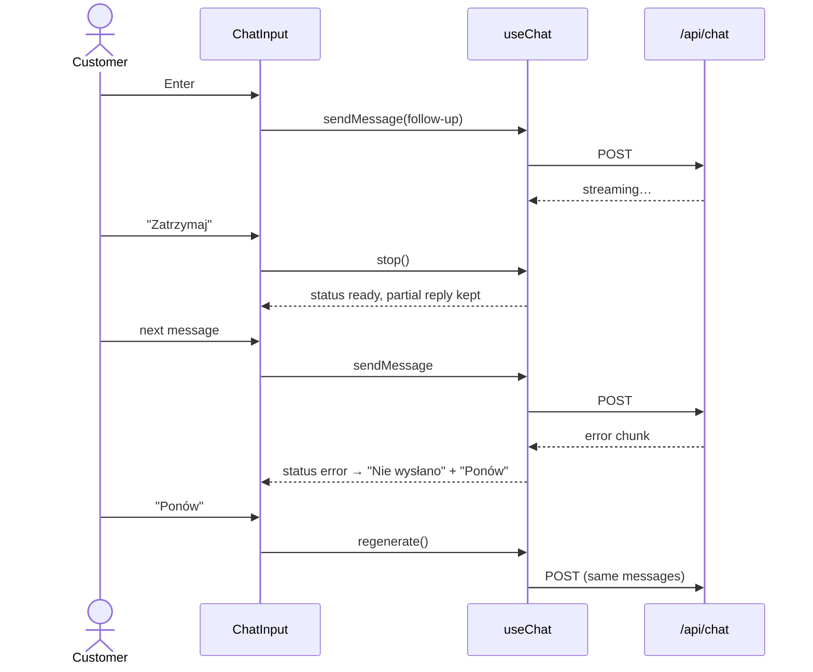

# ADR-004: Frontend — Screens, Session State and Chat UI

**Date:** 2026-10-21
**Status:** Accepted
**Relates to:** `docs/ADR/000-main-architecture.md`

---

## 1. Scope

The single client page: case form (PRD §9.1), processing and error states, chat screen (PRD §9.2), session state, the `useChat` integration with `/api/chat`, rendering of the `set_decision` tool parts, client-side photo validation and reduction, styling with x-kom tokens and accessibility.

Not covered: server behaviour (ADR-002, ADR-003), test suites (ADR-005).

---

## 2. Technology Documentation References

| Library | Context7 ID or official docs | Used for |
|---|---|---|
| AI SDK UI (`@ai-sdk/react` 4) | `/vercel/ai` | `useChat` (`messages`, `status`, `error`, `sendMessage`, `regenerate`, `stop`, `setMessages`, `onError`, `onFinish`), `DefaultChatTransport` with `prepareSendMessagesRequest`, typed tool parts (`tool-set_decision`, states `input-streaming` / `input-available` / `output-available` / `output-error`) |
| AI Elements | `/vercel/ai-elements` | `Conversation` (+ `ConversationContent`, `ConversationScrollButton`; built on `use-stick-to-bottom`, `role="log"`), `Message`/`MessageContent`/`MessageResponse` (Streamdown), `PromptInput` (+ `PromptInputTextarea`, `PromptInputSubmit` with `status`), `Shimmer` |
| shadcn/ui | `/shadcn-ui/ui` | `Button`, `RadioGroup`, `Select`, `Input`, `Textarea`, `Label`, `Dialog`, `AlertDialog`, `Collapsible`, `Badge`; CSS variable theming (Tailwind 4) |
| Next.js | `/vercel/next.js` | `next/font/local`, metadata, client components |
| MDN | https://developer.mozilla.org/en-US/docs/Web/API/Window/createImageBitmap, https://developer.mozilla.org/en-US/docs/Web/API/HTMLCanvasElement/toBlob, https://developer.mozilla.org/en-US/docs/Web/API/Window/beforeunload_event | Photo reduction, leave-page confirmation |

---

## 3. Component Design

### 3.1 Component tree

```
app/layout.tsx                    <html lang="pl">, Instrument Sans, metadata, Toaster
└─ app/page.tsx                   server component rendering <CaseFlow/>
   └─ CaseFlow (client)           owns CaseSession reducer + useChat; switches screens
      ├─ AppHeader                logo, "Asystent zwrotów i reklamacji", [NewCaseButton on chat]
      ├─ FormScreen (screen = form | processing)
      │  ├─ Intro + AiNotice (AC-16)
      │  └─ CaseForm
      │     ├─ CaseTypeTiles (RadioGroup, 2 tiles)
      │     ├─ PurchaseChannelField (RadioGroup)
      │     ├─ CategoryField (Select)
      │     ├─ ModelNameField (Input)
      │     ├─ PurchaseDateField (native date input, max = today)
      │     ├─ ReasonField (Textarea + counter)
      │     ├─ PhotoField (drop zone, file input, thumbnail, "Usuń", hints)
      │     ├─ ErrorBanner (submission error + "Spróbuj ponownie")
      │     └─ SubmitButton | ProcessingSteps
      └─ ChatScreen (screen = chat)
         ├─ CaseSummary (sidebar ≥ 1024 px | Collapsible < 1024 px)
         │  ├─ summary fields, DecisionBadge(currentLabel)
         │  └─ PhotoThumbnail → PhotoOverlay (Dialog)
         ├─ MessageList (Conversation)
         │  ├─ ChatMessage* (Message)
         │  │  ├─ DecisionCard (from tool-set_decision parts)
         │  │  ├─ MessageResponse (assistant text, Markdown)
         │  │  ├─ plain text (user)
         │  │  ├─ Disclaimer (first assistant message, AC-28)
         │  │  └─ FailedMarker "Nie wysłano" + "Ponów"
         │  └─ TypingIndicator (status = submitted)
         ├─ ChatInput (PromptInput, counter after 1800, Wyślij/Zatrzymaj)
         └─ NewCaseDialog (AlertDialog)
```

### 3.2 Session state (`lib/session`)

`CaseFlow` holds a `useReducer` with the `CaseSession` model (ADR-000 §5) and exposes it through a context to its children. No `localStorage`, `sessionStorage`, IndexedDB, cookies or URL state are used (AC-48).

| Action | Effect |
|---|---|
| `FORM_CHANGED(field, value)` | Update `formValues`; clear that field's error if errors are shown |
| `PHOTO_SELECTED(file)` / `PHOTO_REMOVED` | Set/clear `originalPhoto` and its preview object URL (revoke the previous URL) |
| `SUBMIT_STARTED` | `screen = processing`, `processingStep = analyzing`, clear `submissionError` |
| `ANALYSIS_SUCCEEDED(caseContext, imageAnalysis, reducedPhoto)` | Store; `processingStep = deciding` |
| `FIRST_CHUNK_RECEIVED` | `screen = chat`, `processingStep = null` |
| `SUBMIT_FAILED(code)` | `screen = form`, keep `formValues` and `originalPhoto`, set `submissionError` |
| `RESET` | Revoke object URLs, return initial state with a new chat id |

`useChat` lives in `CaseFlow` (not inside `ChatScreen`) so the first request can start while the form screen still shows "Przygotowujemy decyzję…". The chat id changes on `RESET`, which gives a fresh `useChat` store.

### 3.3 `useChat` integration

- Hook typed with `CaseUIMessage`. Transport: `DefaultChatTransport` with `api: '/api/chat'` and `prepareSendMessagesRequest` returning `{ id, messages, caseContext, imageAnalysis }`, reading the latter two from a ref updated by the reducer (so the transport object is created once).
- **First turn**: after `ANALYSIS_SUCCEEDED`, call `sendMessage` with text "Przesłano zgłoszenie." and `metadata: { kind: 'case-submission' }`. This message is never rendered.
- **Follow-ups**: `sendMessage({ text, metadata: { kind: 'follow-up' } })`.
- **First content part** (definition used by every rule below): a `tool-set_decision` part in any state, or a `text` part with non-empty text. `step-start`, `reasoning`, source and metadata parts never count; the creation of an empty assistant message does not count either.
- **Transition to chat**: an effect watches `messages`; when the newest assistant message has its first content part, dispatch `FIRST_CHUNK_RECEIVED` (AC-37 — the chat appears with content already streaming).
- **First-turn failure before the switch** (AC-22): if `status` becomes `error` while `screen = processing`, or the submission deadline fires, call `stop()`, `setMessages([])` and dispatch `SUBMIT_FAILED`. "Spróbuj ponownie" re-runs the whole pipeline (validation, reduction, analysis, decision) with the stored data.
- **First-turn failure after the switch** (error chunk, `chunkMs`/`totalMs` timeout, network drop, or the customer pressing "Zatrzymaj" during the first message): if no `set_decision` part with `recorded = true` exists yet, treat it exactly like the failure before the switch (back to the form with the AC-22 banner, data kept). If the decision is already recorded, keep the partial message and show under the assistant bubble "Odpowiedź została przerwana." (product copy) with "Ponów", which calls `regenerate()` and replaces the partial first message. A stop by the customer shows the same notice without the error styling.
- **Submission deadline**: one 60 s timer started at `SUBMIT_STARTED`, covering the analysis fetch and the decision until the first chunk; it aborts the analysis `fetch` via `AbortController` or calls `stop()`.
- **Follow-up deadline** (AC-45): a 60 s timer per send, cleared when the newest assistant message gets its first content part; on expiry `stop()` and mark the last user message failed. This client watchdog is the authority for the 60 s rule; the server `firstChunkMs` is only a safety net (ADR-002 §3.5).
- **Failed follow-up** (AC-45): if `status = error` or the deadline fired, the last user message shows "Nie wysłano" and "Ponów". "Ponów" calls `regenerate()`, which resubmits the existing messages without adding a new user message (no duplicate). Error text: "Nie udało się wysłać wiadomości." (product copy).
- **Stop** (AC-41): while `status` is `submitted` or `streaming`, `PromptInputSubmit` shows "Zatrzymaj" and calls `stop()`; the partial reply stays. The textarea remains editable; Enter does not send while busy.
- **Throttle**: `useChat` option `throttle: 50` (ms) to limit re-renders during streaming.

### 3.4 Photo handling (`lib/image`)

1. **On select** (AC-10–13): reject > 10 MB with "Zdjęcie przekracza limit 10 MB"; read the first 12 bytes and sniff (shared with the server); `unknown` → "Dozwolone formaty: JPG, PNG, WebP". Accepted file replaces the previous one. Input `accept` is `image/jpeg,image/png,image/webp` (a hint only; sniffing is authoritative).
2. **On submit** (AC-19): `createImageBitmap(file, { imageOrientation: 'from-image' })`; scale so the longer edge is ≤ 1568 px (no upscaling); draw on a canvas with a white background (PNG/WebP transparency); `toBlob('image/jpeg', q)` starting at q = 0.85 and decreasing by 0.1 down to 0.45 until ≤ 1 048 576 bytes; if still too large, scale by 0.85 and repeat (max 5 rounds); otherwise fail with `ANALYSIS_FAILED`-style banner. Aspect ratio is preserved.
3. **Display**: the form thumbnail uses the original file's object URL; the chat summary thumbnail uses the reduced JPEG (what the model saw); the overlay (AC-39 "full photo") shows the original file at full resolution, falling back to the reduced JPEG if the browser cannot render the original. Both object URLs are revoked on `RESET`.

### 3.5 Rendering assistant messages

For each assistant message, render parts in order:

| Part | Rendering |
|---|---|
| `tool-set_decision`, state `input-streaming` | Card skeleton with `Shimmer` "Przygotowujemy decyzję…" |
| `tool-set_decision`, `output-available`, `output.recorded = true`, `output.previousLabel = null` | Greeting paragraph (`input.greeting`), then `DecisionCard` with title "Decyzja" and `input.label` |
| `tool-set_decision`, `output-available`, `output.recorded = true`, `output.previousLabel ≠ null` | `DecisionCard` titled "Zaktualizowana decyzja", "poprzednio: <output.previousLabel>", `input.changeReason`, and the fixed reminder "Ocena nadal jest wstępna — ostateczną decyzję podejmuje pracownik sklepu po oględzinach sprzętu." (product copy; satisfies §11.7) |
| `tool-set_decision`, `recorded = false` or `output-error` | Nothing |
| `text` | `MessageResponse` (Streamdown) with images disabled and links disabled (`allowedImagePrefixes` and `allowedLinkPrefixes` empty) |
| `step-start`, other | Nothing |

After the parts of the **first** assistant message, once that message is no longer streaming and contains a recorded decision, render `Disclaimer` with the exact AC-28 text in smaller muted style. User messages render `text` parts as plain text with preserved line breaks (AC-46). The `case-submission` message is skipped. Every assistant bubble has the visible label "Asystent AI".

**Current label** for `CaseSummary`: `deriveCurrentLabel(messages)` from `lib/case/labels.ts` (shared with the server, ADR-002 §3.4).

### 3.6 Screen behaviour

- **Form validation** (AC-15): validation runs on submit with `caseFormSchema` plus photo presence; errors appear under each invalid field (`aria-invalid`, `aria-describedby`); focus moves to the first invalid field in AC-01 order. After the first submit attempt, fields re-validate on change.
- **Conditional fields**: reason label "Opisz problem" with required marker `*` for complaint, "Powód zwrotu (opcjonalnie)" for return (product copy); photo hint per AC-14; both hints hidden until a case type is chosen (PRD §9.1 empty state).
- **Date**: native `<input type="date">` with `max` = today in Europe/Warsaw (disables future dates in Chrome, Edge, Firefox, Safari pickers); typed future dates are caught by validation (AC-06). Interpretation: "today" in AC-06 is the calendar date in Europe/Warsaw, the same zone the server uses for day counts, so client and server validation never disagree.
- **Model name**: `maxLength = 100` on the input, so only the AC-05 minimum-length error can occur.
- **Reason**: `maxLength = 2000`, counter "N / 2000" always visible (AC-09).
- **Processing** (AC-17/18): all controls disabled (`fieldset disabled`); `ProcessingSteps` replaces the submit button, lists "Analizujemy zdjęcie…" and "Przygotowujemy decyzję…", highlights the active one, `aria-live="polite"`.
- **Chat input** (AC-40): trimmed length 1–2000; send disabled when empty; Enter sends, Shift+Enter newline; counter "N / 2000" shown when length > 1800; no attachment control (AC-44).
- **Case summary** (AC-38): case type, purchase channel, category, model name, purchase date, days since purchase (from `caseContext.daysSincePurchase`), reason or "—" when empty, photo thumbnail, and the current decision label styled as in the decision card (empty placeholder until the first decision is recorded).
- **Auto-scroll** (AC-47): provided by `Conversation` (stick-to-bottom; stops when the user scrolls up; `ConversationScrollButton` returns).
- **Leave-page** (AC-49): `beforeunload` listener registered only while `screen = chat`.
- **New case** (AC-50): `AlertDialog` with title "Rozpocząć nowe zgłoszenie?", description "Obecna rozmowa zostanie utracona.", buttons "Anuluj" and "Rozpocznij nowe"; confirm → `stop()` then `RESET`.
- **Photo overlay** (AC-39): `Dialog` with the full reduced photo, close button "Zamknij", Esc and outside click close it; focus returns to the thumbnail.
- **Responsive** (AC-52): ≥ 1024 px two columns (summary 320 px + conversation); < 1024 px summary in a `Collapsible` above the conversation, collapsed by default, trigger shows case type and current label. No horizontal scroll at 360 px.

### 3.7 Styling with x-kom tokens

Tokens from `assets/design-tokens.json` / `docs/design-guidelines.md` are mapped to the shadcn CSS variables in `app/globals.css` (Tailwind 4 `@theme inline`). Light theme only.

| CSS variable | Value | Token |
|---|---|---|
| `--background` | `#FFFFFF` | background.default |
| `--foreground` | `#1A1A1A` | text.primary |
| `--primary` / `--primary-foreground` | `#222222` / `#FFFFFF` | brand.primary / text.onDark |
| `--secondary` / `--secondary-foreground` | `#F7F7F7` / `#444444` | background.light / text.secondary |
| `--muted` / `--muted-foreground` | `#F7F7F7` / `#6E6E6E` | background.light / text.muted |
| `--input` | `#F2F2F2` | background.input |
| `--border` | `#DDDDDD` | border.default |
| `--ring` | `#0082FA` | brand.accent (focus) |
| `--destructive` | `#BE0064` | brand.error |
| `--radius` | `8px` | borderRadius.md |
| `--success`, `--success-bg` | `#007D00`, `#EEF7ED` | brand.success, background.successLight |
| `--promo`, `--promo-bg` | `#6930F0`, `#F4F0FF` | brand.promo, background.promoLight |
| `--info`, `--info-bg` | `#0070CC`, `#F0F8FF` | brand.link, background.infoLight |

Typography: Instrument Sans everywhere; body 14/20, h1 28 bold, h2 26/32 semibold, small 13/16. Buttons: primary `#222222` 48 px / 40 px, radius 8; outline 1 px `rgba(0,0,0,.64)`. Header: white, 72 px, shadow token, logo 218×40 left. Chat bubbles: user `#222222` with white text; assistant `#F7F7F7`. Composer `#F2F2F2`, radius 8. Tiles and cards radius 12.

**Decision styles** (AC-26 — four distinct styles, each with icon and text):

| Label | Background | Text/border | Icon (lucide) |
|---|---|---|---|
| Akceptacja (wstępna) | `--success-bg` | `--success` | `CircleCheck` |
| Odrzucenie (wstępne) | `#FFFFFF` with 1 px `--destructive` border | `--destructive` | `CircleX` |
| Potrzebne dodatkowe informacje | `--info-bg` | `--info` | `CircleHelp` |
| Przekazanie do weryfikacji | `--promo-bg` | `--promo` | `UserSearch` |

Contrast of each text/background pair must be ≥ 4.5:1 (all listed pairs meet this; verify in QA).

### 3.8 Accessibility (AC-53)

All controls reachable by Tab in visual order; tiles and radios operable with arrow keys (Radix RadioGroup); visible focus ring 2 px `--ring`; every input has a `<label>`; errors linked by `aria-describedby`; the drop zone's activation is the "Wybierz zdjęcie" button (keyboard), drag-and-drop is an enhancement; icons have text alternatives; `Conversation` has `role="log"`; dialogs trap focus and restore it.

---

## 4. Data Structures

| Structure | Fields |
|---|---|
| `FormValues` | `caseType \| null`, `purchaseChannel \| null`, `category \| null`, `modelName`, `purchaseDate`, `reason` (all strings empty by default) |
| `FieldErrors` | partial map field → Polish message; plus `photo` |
| `CaseMessageMetadata` | `{ kind: 'case-submission' \| 'follow-up' }` |
| `DecisionView` | `{ label, previousLabel, greeting, changeReason, isUpdate }` derived from a tool part |
| `UiTexts` (`lib/case/texts.ts`) | Every Polish string used by the UI, including PRD-verbatim ones (AC-05/06/07/11/12/14/16/22/28/50) and PRD §9 copy: product name "Asystent zwrotów i reklamacji", tile explanations "Chcę oddać sprawny sprzęt" / "Sprzęt ma wadę lub usterkę", placeholder "np. Samsung Galaxy S24", "Wybierz zdjęcie", "Usuń", "Wyślij zgłoszenie", "Spróbuj ponownie", "Asystent AI", "Wyślij", "Zatrzymaj", "Nowe zgłoszenie", "Nie wysłano", "Ponów", "Zaktualizowana decyzja", "poprzednio:", and the format/size hint "JPG, PNG lub WebP, maks. 10 MB" (product copy) |

---

## 5. Interface Contracts

| Boundary | Contract |
|---|---|
| `CaseForm → submitCase()` | `submitCase(formValues, originalPhoto)`; returns nothing; drives reducer actions |
| `submitCase → /api/analyze` | `FormData` with fields of ADR-003 §4.1 and `photo` = reduced JPEG named `photo.jpg` |
| `ChatScreen ↔ useChat` | `messages`, `status`, `error`, `sendMessage`, `regenerate`, `stop` |
| `DecisionCard` props | `DecisionView` |
| `CaseSummary` props | `caseContext`, `reducedPhotoUrl`, `originalPhotoUrl` (overlay), `currentLabel` |
| Error codes → texts | Submission (form screen): `ANALYSIS_*`, `DECISION_*`, `VALIDATION_ERROR`, `PHOTO_REQUIRED`, `UNSUPPORTED_IMAGE_TYPE`, `PHOTO_TOO_LARGE`, `CONFIGURATION_ERROR`, network failure → AC-22 banner. Follow-up (chat): `DECISION_*`, `VALIDATION_ERROR`, `CONFIGURATION_ERROR`, network failure → "Nie wysłano" + "Ponów"; `CONVERSATION_LIMIT` → non-retryable notice with the ADR-003 §4.5 text, input disabled, pointing to "Nowe zgłoszenie" (no "Ponów"). For HTTP errors the `useChat` transport error carries the response body; the client parses `error.code` from it and falls back to "network failure" when it cannot. |

---

## 6. Technical Decisions

### D-FE1 AI Elements on top of `useChat`
**Status:** Accepted
**Date:** 2026-10-21
**Context:** The chat needs streaming Markdown, auto-scroll, a stop button and brand styling.
**Decision:** Use the vendored AI Elements components with `useChat` from `@ai-sdk/react`; custom `DecisionCard`, `CaseSummary` and form components.
**Rejected alternatives:**
- assistant-ui: second runtime layer (ADR-000 §1.1).
- Hand-written chat components: re-implements streaming Markdown and scrolling.
**Consequences:**
- (+) Built-in streaming behaviours; code is ours to restyle.
- (-) Vendored code must be re-synced manually on upgrades.
**Review trigger:** AI Elements breaking change on re-sync.

### D-FE2 Hidden first user message
**Status:** Accepted
**Date:** 2026-10-21
**Context:** `useChat` streams assistant replies in response to a sent message; the first decision has no visible customer message.
**Decision:** Send a `case-submission` user message that the UI never renders; the server converts it into a fixed instruction.
**Rejected alternatives:**
- Custom fetch + manual stream parsing for the first message: duplicates `useChat`.
**Consequences:**
- (+) One code path for first and follow-up turns; AC-42 history naturally includes the first decision.
- (-) Message list rendering must skip it.
**Review trigger:** `useChat` gains a native "assistant-initiated" turn.

### D-FE3 No form library
**Status:** Accepted
**Date:** 2026-10-21
**Context:** Seven fields with rules already defined in the shared Zod schema.
**Decision:** Controlled inputs + reducer + `caseFormSchema.safeParse` on submit.
**Rejected alternatives:**
- React Hook Form: extra dependency for a single small form.
**Consequences:**
- (+) Same schema as the server, minimal code.
- (-) Focus management written by hand (small).
**Review trigger:** More forms are added.

### D-FE4 Native date input
**Status:** Accepted
**Date:** 2026-10-21
**Context:** AC-06 requires a date picker that disables future dates; AC-53 requires keyboard operability.
**Decision:** `<input type="date" max=today>`.
**Rejected alternatives:**
- shadcn Calendar + Popover: larger, needs its own keyboard/i18n handling.
**Consequences:**
- (+) Native accessibility and mobile pickers; locale-formatted.
- (-) Visual styling of the popup is browser-controlled.
**Review trigger:** QA finds an unusable picker in a target browser.

### D-FE5 Single route, no history entries
**Status:** Accepted
**Date:** 2026-10-21
**Context:** PRD §9.3 — no browser-history navigation; refresh returns to an empty form.
**Decision:** One page; screens are reducer state; no `router.push`.
**Rejected alternatives:**
- `/` and `/chat` routes: refresh on `/chat` would need redirect logic and history entries.
**Consequences:**
- (+) Matches PRD exactly.
- (-) No deep links (not required).
**Review trigger:** Persistence of sessions (deferred feature 2).

---

## 7. Diagrams

### Screen state machine



### Component / data diagram



### Sequence — submission from the client's perspective



### Sequence — stop and retry in chat



---

## 8. Testing Strategy

### Test scenarios for this area

| Scenario | Type | Input | Expected output | Edge cases |
|---|---|---|---|---|
| Field order and options | Unit (RTL) | render form | 7 fields in AC-01 order; options per AC-02–04; nothing preselected | — |
| Inline validation + focus | Unit | submit empty | Each error under its field; focus on case type; no `fetch` call (AC-15) | only photo missing → focus on photo button |
| Conditional reason | Unit | switch return ↔ complaint | label, `*`, min 20 rule, hint texts (AC-07/08/14) | switching keeps typed text |
| Counter and max | Unit | type 2005 chars | value length 2000, "2000 / 2000" (AC-09) | paste |
| Photo checks | Unit | 11 MB file; HEIC; PNG renamed `.jpg` | AC-12 msg; AC-11 msg; accepted | replace file; "Usuń" |
| Reduction | Unit (jsdom with canvas stubs) + E2E (real browsers) | 4000×3000 JPEG 8 MB | longer edge 1568, ≤ 1 MB, same aspect ratio ±1 px | portrait EXIF orientation; transparent PNG |
| Processing state | Unit | pending analyze | controls disabled; step 1 active; then step 2 (AC-17/18) | — |
| First-turn failure | Unit (mock transport) | analyze 502 / stream error / fake timers 60 s | back to form, values + photo kept, banner text AC-22, retry re-submits | stream starting with `step-start` only does not count as first content |
| First-turn failure after switch | Unit (mock transport from capture) | error after tool part; error after `step-start` only; stop during first message | recorded decision → "Odpowiedź została przerwana." + "Ponów" (`regenerate`); no recorded decision → back to form with AC-22 banner | disclaimer absent until a recorded decision exists |
| Conversation limit | Unit | follow-up returns 422 `CONVERSATION_LIMIT` | non-retryable notice, no "Ponów", input disabled | — |
| Decision card rendering | Unit | message fixtures derived from real captures for each label | Correct title, label text, icon, style class; greeting before card | `recorded=false` hidden; `input-streaming` skeleton |
| Updated decision | Unit | follow-up fixture with `previousLabel` | "Zaktualizowana decyzja", "poprzednio: …", reminder; summary label updated (AC-43) | — |
| Disclaimer | Unit | first assistant message finished | Exact AC-28 text once | not rendered on later messages |
| User text plain | Unit | user text "**bold**" | rendered literally (AC-46) | — |
| Chat input rules | Unit | empty, whitespace, 2001 chars, Shift+Enter, busy | AC-40/41 behaviour | — |
| Failed follow-up | Unit | transport error | "Nie wysłano" + "Ponów"; `regenerate` called; message count unchanged (AC-45) | timeout via fake timers |
| New case dialog | Unit | click, cancel, confirm | AC-50 texts; reset to empty form | confirm during streaming stops stream |
| beforeunload | Unit | chat screen vs form | listener only on chat (AC-49) | removed on reset |
| Overlay | Unit | click thumbnail; Esc; outside click | opens/closes; focus restored (AC-39) | — |
| Visual + a11y | E2E + manual | 360, 768, 1024, 1920 px | no horizontal scroll; keyboard-only flow completes; screenshots match brand | — |

### Technical acceptance criteria

- TAC-004-01: No browser storage API is called anywhere in `components/` or `lib/` (static search for `localStorage`, `sessionStorage`, `indexedDB`, `document.cookie`).
- TAC-004-02: The `case-submission` message never appears in the rendered DOM.
- TAC-004-03: The disclaimer DOM text equals the AC-28 string exactly.
- TAC-004-04: `document.documentElement.scrollWidth ≤ window.innerWidth` on both screens at 360 px in Chromium, Firefox and WebKit.
- TAC-004-05: All user-visible strings come from `lib/case/texts.ts`; components contain no hard-coded Polish copy (checked in code review).
