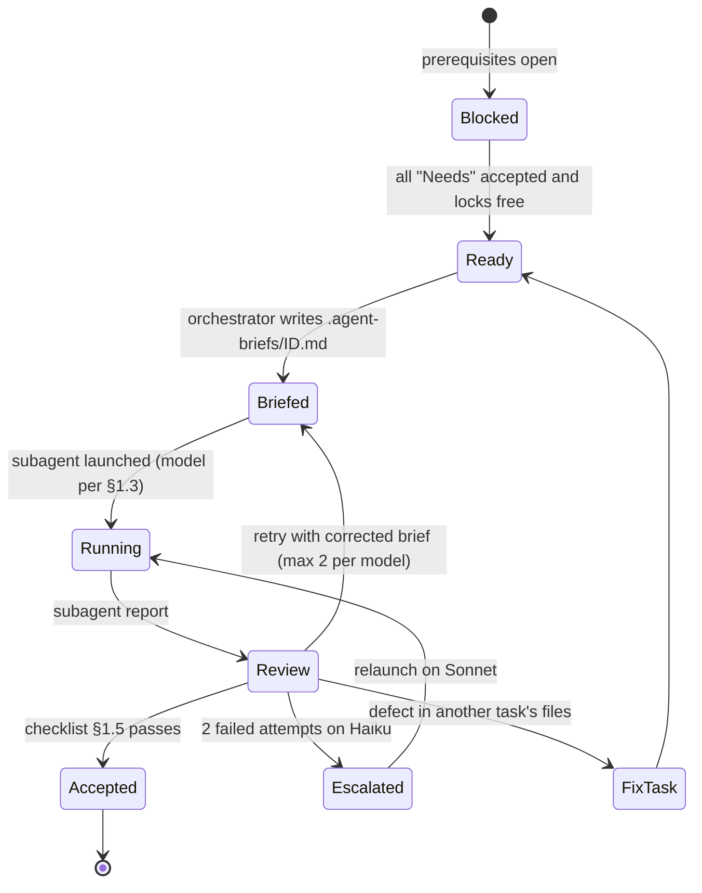
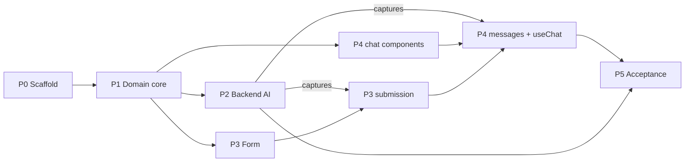

# Implementation Plan — Hardware Service Decision Copilot PoC

**Date:** 2026-10-21
**Branch:** `feature/hardware-service-decision-copilot` (all agents work and commit here)
**Executed by:** an orchestrator agent (strong model) delegating to `be-developer`, `fe-developer`, `qa-engineer` subagents (`.claude/agents/`)

This plan defines **what** is built, **in which order**, **by whom** and **when a task may start**. It does not restate requirements or technical decisions. The sources of truth are:

| Source | Use it for |
|---|---|
| [`docs/PRD.md`](../PRD.md) | Behaviour, Polish texts, acceptance criteria (AC-xx), agent rules (§11) |
| [`docs/ADR/000-main-architecture.md`](../ADR/000-main-architecture.md) | System overview, data models (§5), env vars (§7), decisions |
| [`docs/ADR/001-project-scaffold.md`](../ADR/001-project-scaffold.md) | Template import, keep/remove list, dependencies, configs, target tree (§3.3) |
| [`docs/ADR/002-ai-integration.md`](../ADR/002-ai-integration.md) | OpenRouter, image analyst, decision agent, `set_decision`, prompts, schemas (§4.1) |
| [`docs/ADR/003-backend-api.md`](../ADR/003-backend-api.md) | Route contracts, validation rules, error codes, day calculation |
| [`docs/ADR/004-frontend.md`](../ADR/004-frontend.md) | Screens, session state, `useChat`, rendering, tokens, accessibility |
| [`docs/ADR/005-testing.md`](../ADR/005-testing.md) | Test layers, servers, photos, captures, contract IDs C-xx, E2E IDs E-xx |
| [`docs/design-guidelines.md`](../design-guidelines.md), `assets/` | Brand tokens, logo, font, visual reference `assets/homepage.png` |
| [`AGENTS.md`](../../AGENTS.md) | TDD, verification, Manual QA, commit rules |

In this plan `§` refers to sections of the file named in the same row or cell.

---

## 1. Orchestrator protocol

### 1.1 Responsibilities

The orchestrator **never edits application files**. It:

1. Selects the next runnable task (§3, §4) and the subagent and model (§1.3).
2. Reads the referenced PRD/ADR sections itself and writes a **self-contained brief** to `.agent-briefs/<task-id>.md` (gitignored) using the template in §1.2. The brief copies the exact excerpts needed (field rules, texts, schema fields, commands). It never says "see the ADR" for something the subagent must apply.
3. Launches the subagent with: `Read .agent-briefs/<task-id>.md and execute it exactly.` and the chosen `model`.
4. Reviews the result (§1.5). It may run read-only commands (`git`, `npm run typecheck|lint|test`) to verify.
5. Accepts the task, sends a corrected brief (retry), or escalates the model.
6. Runs autonomously through all phases. It stops and asks the user only on the blockers in §1.7.

It never passes anything from `course-materials/` to subagents and never reads, prints or asks subagents to read `.env`.

### 1.2 Brief template (`.agent-briefs/<task-id>.md`)

Every brief contains these sections, in this order, and only the information needed for that task:

1. **Task** — ID, title, one-paragraph goal, subagent role.
2. **Git rules (verbatim in every brief)** — Work on the current branch `feature/hardware-service-decision-copilot`. Check it first with `git branch --show-current`, and stop if it differs. Do not create branches or worktrees, do not push. Other agents commit to the same branch at the same time. Commit only your files with `git commit -m "<msg>" -- <paths>` after `git add <paths>`. Never use `git add -A`, `git add .`, `git stash`, `git reset`, `git checkout -- .`, `git restore` on files you do not own, or `git rebase`. If git reports `index.lock`, wait 5 s and retry, at most 3 times. Never read or edit `.env`.
3. **Files you own** — exact paths to create or modify. **Files you must not touch** — at least `package.json`/`package-lock.json` (unless the task holds the DEPS lock) and every file owned by a concurrently running task.
4. **Context** — copied excerpts: relevant ACs (verbatim Polish texts), schema fields, contracts, token values, function signatures from earlier tasks (file path + exported names), capture file paths to use.
5. **Steps** — numbered, imperative, no decisions left open:
   - a. Write these tests (names, files, input → expected).
   - b. Run `<command>` and confirm they fail for the stated reason.
   - c. Implement in this order (file → what).
   - d. Run `<commands>` until green.
   - e. Refactor only if green.
   - f. Run the final checks.
6. **Commands** — exact commands with working directory (`app/`). Mark whether a server or build is allowed (RUNTIME lock, §1.6).
7. **Done when** — concrete, checkable criteria (test counts, outputs, HTTP codes).
8. **Commit** — exact message(s) in `Area: summary` form plus the attribution line `Co-Authored-By: Claude <noreply@anthropic.com>`.
9. **Report format** — files changed; tests written; red-run output (one line per failing test); green-run counts (passed/failed/skipped); other check results; commit hash(es); open issues or deviations. No prose beyond this.

### 1.3 Model selection

| Model | Use for |
|---|---|
| **Haiku** (default) | Every task not listed below; all retries of Haiku tasks after a clarified brief |
| **Sonnet** | Tasks marked `Sonnet` in §4 (decision agent and streaming, prompt builders, recorders, `useChat` state machine, manual brand QA), and any Haiku task that failed twice with a clarified brief |
| **Opus** (orchestrator itself) | Planning, writing briefs, reviewing every result, triaging defects, final acceptance |

### 1.4 Task lifecycle

### 1.5 Review checklist (per task)

- [ ] `git log -1 --stat` (or the reported hashes) shows commits on the plan branch, touching **only** owned files.
- [ ] Commit message matches the brief.
- [ ] The report shows a red run before implementation (except tasks marked *no TDD*).
- [ ] `npm run typecheck` and `npm test` pass on the current branch tip (orchestrator re-runs them). The counts match the report, and no tests were skipped without a stated reason.
- [ ] For RUNTIME tasks: the reported Playwright counts per project, plus HTTP evidence or screenshots.
- [ ] No weakened, deleted or skipped tests that were green before. No `fixme` except the two documented in [ADR-005 §3.2](../ADR/005-testing.md).
- [ ] Polish texts and token values match the brief verbatim (spot-check).
- [ ] The diff contains no `course-materials` content, `.env`, secrets or new dependencies (outside DEPS tasks).

### 1.6 Concurrency rules

- **At most 3 subagents run at the same time.** The VM has 4 cores and 8 GB RAM.
- **File ownership:** concurrently running tasks must have disjoint "Files you own". §5.3 lists the owner sequence for shared files.
- **DEPS lock:** only tasks marked `DEPS` may change `package.json`/`package-lock.json` or run `npm install`/CLI generators (`npx shadcn`, `npx ai-elements`). A DEPS task runs alone. If a later task needs a dependency, the subagent stops and reports. The orchestrator then creates a `DEP-nn` task (be-developer, Haiku, DEPS lock) and re-plans.
- **RUNTIME lock:** only tasks marked `RUNTIME` may run `npm run build`, `npm run start`, `npm run dev`, Playwright or capture runs. One RUNTIME task at a time, because ports 3000/3100/3200 and `.next/` are shared. Non-RUNTIME tasks use only `npm run typecheck`, `npm run lint`, `npm test`.
- **Formatting:** subagents run `npx ultracite fix <own files>` only, never on the whole tree.
- **Commits:** each subagent commits its own files at the end of each step in its brief (at least one commit per task).

### 1.7 Blockers (stop and ask the user)

| Condition | Check (never read the file) |
|---|---|
| Root `.env` missing before the first RUNTIME task with real AI (P2-01) | `test -f .env` from the repository root |
| C-01 shows a configured model lacks a required capability | Contract C-01 output |
| OpenRouter returns 401/402/429 repeatedly | Subagent report |
| A requirement conflict between PRD and ADR that the orchestrator cannot resolve from the documents | Orchestrator judgement |

The missing HEIC and > 10 MB photos are **not** blockers: the tests are `fixme` per [ADR-005 §3.2](../ADR/005-testing.md).

---

## 2. Phases overview

| Phase | Goal | Exit criteria |
|---|---|---|
| **P0 Scaffold** | Template imported, stripped, configured; app starts with header | [ADR-001 §8](../ADR/001-project-scaffold.md) TAC-001-01…06 pass; screenshot of `/` |
| **P1 Domain core** | Shared texts, schemas, days, sniffing, message types | All `lib/case`, `lib/image/sniff` unit tests green |
| **P2 Backend AI** | `/api/analyze` and `/api/chat` work against real OpenRouter | C-01…C-08 green; reliability run reported; first captures committed; integration tests green |
| **P3 Form** | Form screen with validation, photo handling, submission, processing and error states | E-01, E-02, E-21 green in Chromium + `@smoke` browsers |
| **P4 Chat** | Chat screen with streamed decision, follow-ups, summary, dialogs | E-03…E-22 green in Chromium; `@smoke` green in Firefox/WebKit |
| **P5 Acceptance** | Defects fixed; full verification; manual QA; report | AGENTS.md Completion Criteria met; final report delivered |

P2, P3 and P4 overlap in time. P3 and P4 front-end work that does not need real backend shapes starts as soon as P1 is accepted.

---

## 3. Execution waves (what may run in parallel)

Within a wave, tasks on separate lines may run concurrently (respecting §1.6). An arrow means the task must be accepted first.

| Wave | Backend lane (be) | Frontend lane (fe) | QA lane (qa) |
|---|---|---|---|
| W0 | P0-01 → P0-02 → P0-03 | → P0-04 (after P0-03) | → P0-05 (after P0-04) ∥ P0-06 (be, docs) |
| W1 | P1-02 ∥ P1-03 → P1-04 (after P1-01, P1-02) → P1-05 | P1-01 | P1-06 |
| W2 | P2-04 ∥ P2-05 | P3-02 → P3-03 ∥ P3-04 ∥ P4-02 ∥ P4-04 (max 3 agents total) | P2-01 → P2-02 → P2-03 → P3-01 → P4-01 |
| W3 | P2-06 → P2-07 → (P2-08 qa) → P2-09 | P3-05 (after P2-08), P4-03 (after P2-08) | P2-08, P2-10 |
| W4 | — | P4-05 → P4-06 | P3-06 (after P3-05), P4-07 (after P4-06) |
| W5 | FIX tasks | FIX tasks | P5-02 → P5-03 → P5-04 |

---

## 4. Task catalogue

Legend:
- **Locks:** `DEPS`, `RUNTIME` (§1.6).
- **TDD:** tests written and seen failing first. *No TDD* is marked where nothing testable exists yet (scaffold, docs).
- **Refs:** the sections the orchestrator copies from into the brief.
- **Paths:** a path starting with `app/` is relative to the repository root; every other path in "Files owned" is relative to `app/` (e.g. `lib/case/texts.ts` = `app/lib/case/texts.ts`, `app/app/page.tsx` = the Next.js page).

### P0 — Scaffold

| ID | Agent / model | Needs | Locks | Files owned | Refs | Work | Done when | Commit |
|---|---|---|---|---|---|---|---|---|
| P0-01 | be / Haiku | — | DEPS | `app/**` | ADR-001 §3.2 steps 1–2, D-S1 | Precondition checks; `degit` import at the pinned commit; license check. *No TDD* | `app/package.json` has `"ai": "7.0.15"`; `app/LICENSE` is Apache-2.0 | `Scaffold: Import vercel/chatbot template at c2f8235` |
| P0-02 | be / Haiku | P0-01 | DEPS | `app/**` | ADR-001 §3.2 steps 3–5 and 11, §3.4 Remove, §3.5, §3.6 | Delete the Remove list; switch to npm; uninstall/add deps; scripts; placeholder `app/app/page.tsx` and 501 stubs for both routes. *No TDD* | `npm ls --depth=0` clean; `npm run typecheck` and `npm run build` exit 0; TAC-07 deps absent | `Scaffold: Strip template to PRD scope and switch to npm` |
| P0-03 | be / Haiku | P0-02 | DEPS | `app/tsconfig.json`, `next.config.ts`, `biome.jsonc`, `vitest.config.ts`, `tests/setup/**`, `playwright.config.ts`, `playwright.capture.config.ts`, `tests/global-setup.ts`, `.gitignore`, `lib/utils.test.ts` | ADR-001 §3.2 steps 8, 10, §3.7; ADR-005 §3.1 (servers, Vitest dummy env + fetch guard); ADR-000 §7 (root `.env` via `@next/env`) | Configs; smoke test for `cn()` first | `npm test` 1 passed; typecheck, lint, build exit 0; no `app/.env*` | `Scaffold: Configure TypeScript, Next, Biome, Vitest and Playwright` |
| P0-04 | fe / Haiku | P0-03 | DEPS | `components/ai-elements/**`, `components/ui/**`, `components/layout/app-header.tsx`, `app/app/layout.tsx`, `app/app/globals.css`, `app/app/favicon.ico`, `app/app/fonts/**`, `public/logo.svg`, `app/app/page.tsx`, `package*.json` (CLI only) | ADR-001 §3.2 steps 6, 7, 9; ADR-004 §3.7 token table, typography, header; design-guidelines (Header, Logo usage) | Re-sync AI Elements; add radio-group; copy assets; tokens in CSS; layout (`lang="pl"`, font); header component test first (logo alt, title text) | Header test green; build passes | `Frontend: Add brand tokens, font, logo and AI Elements components` |
| P0-05 | qa / Haiku | P0-04 | RUNTIME | none (report only; screenshots under `app/test-results/qa/P0-05/`) | ADR-001 §8 table, TAC-001-01…06; AGENTS.md Manual QA 1–2 | Run clean install, typecheck, lint, test, build; start; Playwright CLI screenshot at 360/1440 px; compare header with brand | All checks pass; screenshots exist | — (no commit) |
| P0-06 | be / Haiku | P0-04 | — | `app/AGENTS.md`, `app/README.md` | ADR-001 §3.2 step 13, §3.5 | Short app guide: stack, commands, "consult Context7 `/vercel/ai` before AI code". General info only. *No TDD* | Commands verified to exist in `package.json` | `Docs: Add app AGENTS.md and README` |

### P1 — Domain core (`app/lib/case`, `app/lib/image/sniff.ts`)

| ID | Agent / model | Needs | Locks | Files owned | Refs | Work | Done when | Commit |
|---|---|---|---|---|---|---|---|---|
| P1-01 | fe / Haiku | P0-03 | — | `lib/case/texts.ts`, `lib/case/texts.test.ts` | PRD AC-05, 06, 07, 11, 12, 14, 16, 22, 25, 28, 50; PRD §9.1; ADR-003 §4.1, §4.5; ADR-004 §3.5, §3.6, §4 `UiTexts` | One exported object of all Polish strings; tests assert PRD-verbatim strings character by character | Tests green | `Frontend: Add Polish UI texts` |
| P1-02 | be / Haiku | P0-03 | — | `lib/case/days.ts`, `lib/case/days.test.ts` | ADR-003 §5.3, §8 rows "Days", "Future date" | `todayInWarsaw`, `daysSincePurchase` | Boundary and DST tests green | `Backend: Add Warsaw calendar day calculation` |
| P1-03 | be / Haiku | P0-03 | — | `lib/image/sniff.ts`, `lib/image/sniff.test.ts` | ADR-003 §3 "Sniffing", D-API2, §8 row "Sniff"; ADR-004 §3.4 step 1 limits | `sniffImage(bytes)` → `jpeg/png/webp/unknown` + media type; `isWithinSize(bytes, limit)` | Tests green | `Backend: Add image content sniffing and size checks` |
| P1-04 | be / Haiku | P1-01, P1-02 | — | `lib/case/constants.ts`, `lib/case/schemas.ts`, `lib/case/errors.ts` + tests | ADR-000 §5; ADR-002 §4.1 (incl. `seals`, common `safetyHazards`); ADR-003 §4.1–§4.5 | Enums with Polish labels; all Zod schemas (form, case context, image analysis union + two model-facing variant schemas, analyze response, chat request without count cap, error envelope); error codes → messages from `texts.ts` | Schema boundary tests (ADR-003 §8 rows 1–2) green | `Backend: Add case schemas, constants and error codes` |
| P1-05 | be / Haiku | P1-04 | — | `lib/case/messages.ts`, `lib/case/labels.ts` + tests | ADR-000 §5 `CaseUIMessage`; ADR-002 §3.4 (input/output/history schemas, `deriveCurrentLabel`) | Message metadata schema, `set_decision` schemas, `CaseUIMessage` type, label display map, `deriveCurrentLabel` | ADR-002 §8 row "deriveCurrentLabel" green | `Backend: Add chat message types and decision label derivation` |
| P1-06 | qa / Haiku | P0-03 | — | `tests/README.md` | ADR-005 TAC-005-04, §4.1, §5; PRD §6 | AC-01…AC-54 → test IDs / manual QA step table (status column "planned"). *No TDD* | Every AC has ≥ 1 entry | `Tests: Add AC traceability table` |

### P2 — Backend AI and endpoints

Contract specs are written first by QA and must fail against the 501 stubs. This is the bootstrap red step from [ADR-005 §3.5](../ADR/005-testing.md).

| ID | Agent / model | Needs | Locks | Files owned | Refs | Work | Done when | Commit |
|---|---|---|---|---|---|---|---|---|
| P2-01 | qa / Haiku | P1-04, root `.env` present | RUNTIME | `tests/contract/helpers/**`, `tests/contract/analyze.contract.ts` | ADR-005 §5 C-01, C-02, C-03, §3.2 photo table; ADR-003 §5.1 | Multipart helper; C-01 (models), C-02 (`@capture`), C-03; run → C-02/C-03 fail with 501 | Red run reported; C-01 result reported (blocker if it fails) | `Tests: Add analyze contract specs` |
| P2-02 | qa / Haiku | P2-01, P1-05 | RUNTIME | `tests/contract/helpers/sse.ts`, `tests/contract/chat.contract.ts` | ADR-005 §5 C-04, C-05, C-06; ADR-003 §5.2 | SSE chunk parser; C-04, C-05 (`@capture`), C-06; red run | Red run reported | `Tests: Add chat contract specs` |
| P2-03 | qa / Haiku | P2-02 | RUNTIME | `tests/contract/decision-matrix.contract.ts` | ADR-005 §5 C-07 (a–e), C-08 (f); ADR-002 §4.1 field names | Hand-written analyses, set-membership assertions; red run | Red run reported | `Tests: Add decision matrix contract specs` |
| P2-04 | be / **Sonnet** | P1-04, P0-03 | — | `lib/ai/env.ts`, `lib/ai/provider.ts`, `lib/ai/recorders.ts`, `lib/ai/log.ts` + tests | ADR-002 §3.1 (env, provider), §3.5, §3.6, D-AI5; ADR-005 §3.3 recorders; ADR-000 §7 | Env parsing with `VISION_MODEL` fallback; OpenRouter factory with model settings; passive fetch + middleware recorders gated by `AI_CAPTURE_DIR`; redacting logger | Unit tests: env, recorder passivity, TAC-002-05 green | `Backend: Add OpenRouter provider, env config, recorders and logging` |
| P2-05 | be / **Sonnet** | P1-05 | — | `lib/ai/policies.ts`, `lib/ai/prompts/image-analyst.ts`, `lib/ai/prompts/decision-agent.ts` + tests | ADR-002 §3.2 instruction content, §3.3 (all 6 parts), D-AI3, D-AI7, D-AI8; PRD §11.2–§11.9; `docs/policies/*` | Policy loader with §7 extraction; four instruction sets; delimited case data. The orchestrator writes the full instruction text outline into the brief | ADR-002 §8 rows for instructions + TAC-002-04 + TAC-08 green | `Backend: Add policy loader and agent instructions` |
| P2-06 | be / Haiku | P2-01, P2-04, P2-05, P1-03 | RUNTIME | `lib/ai/image-analyst.ts`, `lib/ai/errors.ts`, `app/app/api/analyze/route.ts` + unit tests for error mapping | ADR-002 §3.2, §5.1, §5.3; ADR-003 §5.1 processing order | Implement against red C-02/C-03; error-mapping unit tests first | C-02, C-03 green on real OpenRouter (counts reported) | `Backend: Implement /api/analyze with the image analyst` |
| P2-07 | be / **Sonnet** | P2-06, P2-02 | RUNTIME | `lib/ai/tools.ts`, `lib/ai/decision-agent.ts`, `app/app/api/chat/route.ts` + unit tests for tool execute | ADR-002 §3.3 call + step control, §3.4, §5.2; ADR-003 §5.2 | `set_decision` factory with `currentLabel`; streaming turn; route | C-04, C-05, C-06 green on real OpenRouter | `Backend: Implement /api/chat with the decision agent` |
| P2-08 | qa / Haiku | P2-07 | RUNTIME | `tests/fixtures/captures/<date>/**` | ADR-005 §3.3 | `npm run capture`; verify files and `meta.json`, no `Authorization`. *No TDD* | Captures for C-02 (each photo × case type), C-04, C-05 committed | `Tests: Add first real OpenRouter captures` |
| P2-09 | be / Haiku | P2-08 | — | `tests/integration/**`, `tests/helpers/capture-model.ts` | ADR-005 §3.1 integration row, §3.5 bootstrap exception; ADR-003 §8 integration rows; ADR-002 §8 integration rows | Helper building `MockLanguageModelV4` from captured parts; route integration tests (characterization) | `npm test` green offline (TAC-005-03) | `Tests: Add route integration tests from captures` |
| P2-10 | qa / Haiku | P2-07, P2-03 | RUNTIME | none (report) | ADR-005 §3.4 reliability; C-07, C-08 | Run C-01…C-08; `--repeat-each=3` for C-04, C-07, C-08; pass rates | Report; failures → orchestrator creates FIX tasks (prompt tuning on P2-05/P2-07 files, Sonnet) | — |

### P3 — Form screen

| ID | Agent / model | Needs | Locks | Files owned | Refs | Work | Done when | Commit |
|---|---|---|---|---|---|---|---|---|
| P3-01 | qa / Haiku | P2-03, P1-01 | — | `tests/e2e/pages/form.page.ts`, `tests/e2e/form.spec.ts`, `tests/e2e/reduction.spec.ts` | ADR-005 §4.1 E-01, E-02, E-21, §3.2 photos (`fixme` cases); PRD AC-01…16, 19 | Page object + specs (not run yet: UI missing). *Red verified in P3-06* | Specs typecheck | `Tests: Add form E2E specs` |
| P3-02 | fe / Haiku | P1-04, P0-04 | — | `lib/session/**`, `components/case-flow.tsx`, `app/app/page.tsx` + tests | ADR-004 §3.1 tree, §3.2 actions table | Reducer + context with tests first; `CaseFlow` switches form/chat placeholders | Reducer tests green | `Frontend: Add case session state and screen switch` |
| P3-03 | fe / Haiku | P3-02 | — | `components/case-form/case-form.tsx`, `case-type-tiles.tsx`, `field-*.tsx`, `ai-notice.tsx` + tests | PRD AC-01…09, 15, 16, §9.1; ADR-004 §3.6 (validation, conditional fields, date, model name, reason), §3.8; ADR-004 §8 rows 1–4 | Fields, client validation with `caseFormSchema`, focus first invalid | ADR-004 §8 form rows green | `Frontend: Add case form fields and validation` |
| P3-04 | fe / Haiku | P3-02, P1-03 | — | `components/case-form/photo-field.tsx`, `lib/image/reduce.ts` + tests | PRD AC-10…14, 19; ADR-004 §3.4; ADR-004 §8 rows "Photo checks", "Reduction" | Drop zone, thumbnail, "Usuń", hints; reduction algorithm | Unit tests green (real files from `assets/example-images/` in component test) | `Frontend: Add photo field and client-side reduction` |
| P3-05 | fe / Haiku | P3-03, P3-04, P2-08 | — | `components/case-form/case-form.tsx` (integration), `processing-steps.tsx`, `error-banner.tsx`, `lib/session/submit-case.ts` + tests | PRD AC-17, 18, 22; ADR-004 §3.3 (submission deadline, first-turn failure before switch), §3.6 processing; analyze capture path from P2-08 | Submit pipeline up to `ANALYSIS_SUCCEEDED` (chat start stubbed via injected callback), disabled form, step labels, banner + retry | ADR-004 §8 rows "Processing state", "First-turn failure" (analysis part) green | `Frontend: Add case submission, processing and error states` |
| P3-06 | qa / Haiku | P3-05, P3-01, P2-06 | RUNTIME | none (report) | ADR-005 §4.1 E-01, E-02, E-21 | Run in Chromium + `@smoke` in Firefox/WebKit | Green except the 2 documented `fixme`; FIX tasks for failures | — |

### P4 — Chat screen

| ID | Agent / model | Needs | Locks | Files owned | Refs | Work | Done when | Commit |
|---|---|---|---|---|---|---|---|---|
| P4-01 | qa / Haiku | P3-01 | — | `tests/e2e/pages/chat.page.ts`, `tests/e2e/chat-*.spec.ts`, `tests/e2e/failure.spec.ts` | ADR-005 §4.1 E-03…E-20, E-22; §3.4 assertion rules | Page object + specs (not run yet) | Specs typecheck | `Tests: Add chat E2E specs` |
| P4-02 | fe / Haiku | P3-02, P1-05 | — | `components/chat/chat-screen.tsx`, `case-summary.tsx`, `decision-badge.tsx`, `photo-overlay.tsx` + tests | PRD AC-26, 38, 39, 52; ADR-004 §3.6 (summary, overlay, responsive), §3.7 decision styles | Layout (sidebar ≥ 1024 px / collapsible), summary fields, 4 badge styles, overlay | Unit tests green | `Frontend: Add chat layout, case summary and photo overlay` |
| P4-03 | fe / Haiku | P2-08, P1-05, P4-02 | — | `components/chat/message-list.tsx`, `chat-message.tsx`, `decision-card.tsx`, `disclaimer.tsx` + tests + `tests/fixtures/messages/**` (derived from captures) | PRD AC-24…28, 43, 46, 47; ADR-004 §3.5 rendering table; §8 rows "Decision card", "Updated decision", "Disclaimer", "User text plain" | Part rendering incl. greeting + card, updated card + reminder, hidden case-submission, disclaimer rule | Unit tests green | `Frontend: Add message rendering and decision cards` |
| P4-04 | fe / Haiku | P3-02 | — | `components/chat/chat-input.tsx`, `failed-marker.tsx`, `new-case-dialog.tsx`, `lib/session/use-leave-guard.ts` + tests | PRD AC-40, 41, 44, 49, 50; ADR-004 §3.6 (chat input, leave-page, new case) | Input rules, stop button, failed marker UI, dialog, `beforeunload` hook | Unit tests green | `Frontend: Add chat input, failure marker and new-case dialog` |
| P4-05 | fe / **Sonnet** | P3-05, P4-02, P4-03, P4-04, P2-08 | — | `components/case-flow.tsx`, `lib/session/chat-transport.ts`, `lib/session/watchdog.ts` + tests | PRD AC-22, 37, 41, 42, 45; ADR-004 §3.3 entire, §5 error mapping; ADR-002 §3.5 (client watchdog authority) | `useChat` with transport, hidden first message, first-content-part rule, transitions, failures before/after switch, follow-up watchdog, `regenerate`, error-code mapping | ADR-004 §8 rows for first-turn failure (both), failed follow-up, request too large green | `Frontend: Integrate useChat with session flow and watchdogs` |
| P4-06 | fe / Haiku | P4-05 | — | `components/chat/chat-screen.tsx`, `components/case-flow.tsx` (wiring only) + tests | ADR-004 §3.1 tree, §3.6, §3.8 | Wire messages/status/stop/regenerate/current label/reset into the chat screen; a11y attributes | Unit tests green; manual smoke left to QA | `Frontend: Wire chat screen to the chat session` |
| P4-07 | qa / Haiku | P4-06, P4-01, P2-07 | RUNTIME | none (report) | ADR-005 §4.1 E-03…E-22; §3.4 | Run Chromium all, Firefox/WebKit `@smoke`, `failure` project | Report with counts and labels logged; FIX tasks for failures | — |

### P5 — Hardening and acceptance

| ID | Agent / model | Needs | Locks | Files owned | Refs | Work | Done when | Commit |
|---|---|---|---|---|---|---|---|---|
| FIX-nn | owner of the failing file / Haiku (Sonnet after 2 failures or for AI/streaming files) | the failing report | as needed | files of the defect only | Defect report + the refs of the original task | Reproducing test first (unit/integration, or the failing E2E as red), then minimal fix | Reproducer green; nothing else red | `<Area>: Fix <defect>` |
| P5-01 | qa / Haiku | all P2–P4 accepted, no open FIX | RUNTIME | none (report) | AGENTS.md Verification; ADR-005 §4.2; TAC-03, TAC-07, TAC-004-01, TAC-005-01/03/06 | Full suite: typecheck, lint, test, build, contract, E2E all projects; reliability `--repeat-each=3` for C-04, C-07, C-08, E-03…E-11; p95 time-to-first-content; static TAC checks | All green or documented `fixme`; report per ADR-005 §4.2 | — |
| P5-02 | qa / **Sonnet** | P5-01 | RUNTIME | none (screenshots under `app/test-results/qa/P5-02/`) | ADR-005 §3.6 steps 1–7; AGENTS.md Manual QA; design-guidelines; `assets/homepage.png` | Manual QA with Playwright CLI incl. network objects, AC-45 server-stop check, brand comparison at 360/1440 px | Report with screenshots and per-photo assessments; FIX tasks for findings | — |
| P5-03 | qa / Haiku | P5-02, no open FIX | — | `tests/README.md` | ADR-005 TAC-005-04 | Set the final status per AC in the traceability table | Every AC "passed" or explicitly "fixme/manual" with reason | `Tests: Update AC traceability with final results` |
| P5-04 | orchestrator | P5-03 | — | — | AGENTS.md Completion Criteria | Final review of the branch (`git log`, diff stat), consolidated verification report to the user: commits, counts, screenshots, open items (HEIC/10 MB photos, PRD open questions) | Report delivered; nothing pushed | — |

---

## 5. Matrices

### 5.1 Dependency matrix (task → must be accepted first)

| Task | Needs | Unblocks |
|---|---|---|
| P0-01 | — | P0-02 |
| P0-02 | P0-01 | P0-03 |
| P0-03 | P0-02 | P0-04, P1-01, P1-02, P1-03, P1-06, P2-04 |
| P0-04 | P0-03 | P0-05, P0-06, P3-02 |
| P0-05 | P0-04 | — (gate for W1 start) |
| P0-06 | P0-04 | — |
| P1-01 | P0-03 | P1-04, P3-01 |
| P1-02 | P0-03 | P1-04 |
| P1-03 | P0-03 | P2-06, P3-04 |
| P1-04 | P1-01, P1-02 | P1-05, P2-01, P2-04, P3-02 |
| P1-05 | P1-04 | P2-02, P2-05, P4-02, P4-03 |
| P1-06 | P0-03 | P5-03 |
| P2-01 | P1-04, root `.env` | P2-02, P2-06 |
| P2-02 | P2-01, P1-05 | P2-03, P2-07 |
| P2-03 | P2-02 | P2-10, P3-01 |
| P2-04 | P1-04, P0-03 | P2-06 |
| P2-05 | P1-05 | P2-06 |
| P2-06 | P2-01, P2-04, P2-05, P1-03 | P2-07, P3-06 |
| P2-07 | P2-06, P2-02 | P2-08, P2-10, P4-07 |
| P2-08 | P2-07 | P2-09, P3-05, P4-03, P4-05 |
| P2-09 | P2-08 | P5-01 |
| P2-10 | P2-07, P2-03 | P5-01 |
| P3-01 | P2-03, P1-01 | P3-06, P4-01 |
| P3-02 | P1-04, P0-04 | P3-03, P3-04, P4-02, P4-04 |
| P3-03 | P3-02 | P3-05 |
| P3-04 | P3-02, P1-03 | P3-05 |
| P3-05 | P3-03, P3-04, P2-08 | P3-06, P4-05 |
| P3-06 | P3-05, P3-01, P2-06 | P5-01 |
| P4-01 | P3-01 | P4-07 |
| P4-02 | P3-02, P1-05 | P4-03, P4-05 |
| P4-03 | P2-08, P1-05, P4-02 | P4-05 |
| P4-04 | P3-02 | P4-05 |
| P4-05 | P3-05, P4-02, P4-03, P4-04, P2-08 | P4-06 |
| P4-06 | P4-05 | P4-07 |
| P4-07 | P4-06, P4-01, P2-07 | P5-01 |
| P5-01 | P2-09, P2-10, P3-06, P4-07, no open FIX | P5-02 |
| P5-02 | P5-01 | P5-03 |
| P5-03 | P5-02 | P5-04 |
| P5-04 | P5-03 | — |

The QA lane runs P2-01 → P2-02 → P2-03 → P3-01 → P4-01 sequentially because these tasks share `tests/contract/helpers` and page objects. The RUNTIME lock serializes P2-01/02/03 with P2-06/07.

### 5.2 Agent workload matrix

| Agent | Tasks | Sonnet tasks |
|---|---|---|
| be-developer | P0-01, P0-02, P0-03, P0-06, P1-02, P1-03, P1-04, P1-05, P2-04, P2-05, P2-06, P2-07, P2-09 | P2-04, P2-05, P2-07 |
| fe-developer | P0-04, P1-01, P3-02, P3-03, P3-04, P3-05, P4-02, P4-03, P4-04, P4-05, P4-06 | P4-05 |
| qa-engineer | P0-05, P1-06, P2-01, P2-02, P2-03, P2-08, P2-10, P3-01, P3-06, P4-01, P4-07, P5-01, P5-02, P5-03 | P5-02 |

### 5.3 Shared-file ownership sequence

| File / area | Owners in order | Rule |
|---|---|---|
| `package.json`, `package-lock.json` | P0-01 → P0-02 → P0-03 → P0-04 → DEP-nn only | DEPS lock |
| `app/app/page.tsx` | P0-02 → P0-04 → P3-02 | Then frozen (renders `CaseFlow`) |
| `components/case-flow.tsx` | P3-02 → P4-05 → P4-06 | Never concurrent |
| `components/case-form/case-form.tsx` | P3-03 → P3-05 | P3-04 must not edit it |
| `components/chat/chat-screen.tsx` | P4-02 → P4-06 | — |
| `lib/session/**` | P3-02 → P3-05 → P4-04 (`use-leave-guard.ts` only) → P4-05 | Distinct files where concurrent |
| `lib/case/texts.ts` | P1-01, then FIX only | New copy needed later → FIX task by fe |
| `lib/case/schemas.ts`, `messages.ts` | P1-04 / P1-05, then FIX only | Shape changes require re-capture (ADR-005 §3.3) |
| `lib/ai/prompts/**`, `policies.ts` | P2-05, then prompt FIX tasks (Sonnet) | — |
| `tests/contract/**` | P2-01 → P2-02 → P2-03 | QA lane sequential |
| `tests/e2e/**` | P3-01 → P4-01 | QA lane sequential |
| `tests/fixtures/captures/**` | P2-08, later re-captures by qa | Never hand-edited |
| `tests/README.md` | P1-06 → P5-03 | — |

---

## 6. Coverage map (AC → implementing / verifying tasks)

| ACs | Implement | Verify |
|---|---|---|
| AC-01…09, 15, 16 | P1-01, P1-04, P3-03 | P3-06 (E-01) |
| AC-10…14 | P1-03, P3-04 | P3-06 (E-02; AC-11/12 `fixme`) |
| AC-17, 18, 22 | P3-05, P4-05 | P3-06, P4-07 (E-03, E-22) |
| AC-19 | P3-04 | P3-06 (E-21) |
| AC-20, 21, 29…36 | P2-05, P2-06, P2-07 | P2-10 (C-07, C-08), P4-07 (E-04…E-08) |
| AC-23 | P2-04 | P4-07 (E-19), P5-01 (TAC-03) |
| AC-24…28, 37 | P2-07, P4-03, P4-05 | P2-02 (C-04), P4-07 (E-03) |
| AC-38, 39 | P4-02 | P4-07 (E-03, E-17) |
| AC-40, 41, 44, 46, 47 | P4-03, P4-04, P4-06 | P4-07 (E-14) |
| AC-42, 43 | P2-07, P4-03, P4-05 | P2-10 (C-08), P4-07 (E-11) |
| AC-45 | P4-04, P4-05 | P5-02 (manual step 4) |
| AC-48, 49, 50 | P3-02, P4-04 | P4-07 (E-15, E-16, E-20) |
| AC-51 | P2-05 | P4-07 (E-13) |
| AC-52, 53 | P4-02, P4-06 | P4-07 (E-18), P5-02 |
| AC-54 | P1-01, P3-03, P4-03 | P4-07 (E-01, E-03) |

---

## 7. Definition of done for the PoC

- Every task in §4 is accepted, and no FIX task is open.
- P5-01 report: typecheck, lint, unit+integration, build, contract and E2E (all projects) green. The only skips are the two documented `fixme` cases. Reliability pass rates and p95 time-to-first-content are reported.
- P5-02 manual QA passed with screenshots compared against the brand reference.
- `tests/README.md` maps every AC to its final status.
- All work is committed on `feature/hardware-service-decision-copilot`; nothing is pushed.
